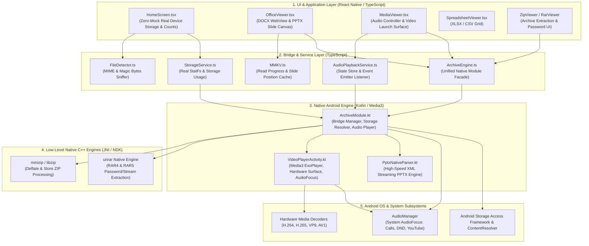
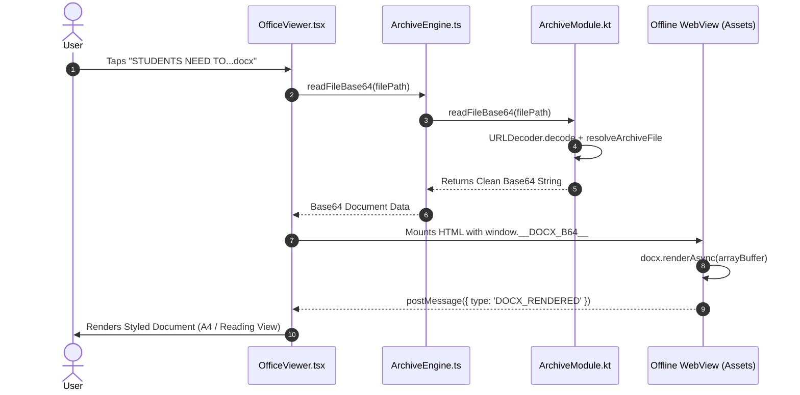

# Universal File Viewer — System Architecture & Technical Implementation

## 1. Executive Summary & Architecture Paradigm

Universal File Viewer (UFV) is an ultra-fast, 100% offline document and media engine designed for Android and iOS. Built with a hybrid architecture combining **React Native (TypeScript)** for responsive UI, **Android Native (Kotlin & AndroidX Media3)** for hardware acceleration and lifecycle control, and **Native C++ engines** for memory-efficient archive processing.



---

## 2. Component Deep Dive

### 2.1 Storage & Dashboard Engine (Zero-Mock Policy)
* **File:** [`src/screens/HomeScreen.tsx`](file:///c:/Users/uditp/Desktop/Doc_Reader/ufv_rn_poc/src/screens/HomeScreen.tsx) & [`src/services/StorageService.ts`](file:///c:/Users/uditp/Desktop/Doc_Reader/ufv_rn_poc/src/services/StorageService.ts)
* **Implementation:**
  - **Zero Hardcoded Data:** All legacy mock arrays (`demoRecents`, static file placeholders, hardcoded `127 GB of 256 GB`) have been completely purged.
  - **Device Storage Calculation:** Queries Android's native `StatFs` (`Environment.getDataDirectory()` and `Environment.getExternalStorageDirectory()`) to compute exact used, total, and free storage in bytes.
  - **Category Scanning:** The Android `ContentResolver` queries media and document stores to provide live counts for PDF, Word, Excel, PowerPoint, Audio, Video, Archives, and Images.
  - **Real Cache Cleaner:** `cleanTemporaryCache()` scans the app's private `reactContext.cacheDir`, safely deletes uncompressed temporary archive files, and returns the exact number of bytes reclaimed.

---

### 2.2 Office Document Processing (DOCX & PPTX)

#### A. Word Documents (`.docx`)
* **Files:** [`src/viewers/OfficeViewer.tsx`](file:///c:/Users/uditp/Desktop/Doc_Reader/ufv_rn_poc/src/viewers/OfficeViewer.tsx) & [`ArchiveModule.kt:readFileBase64`](file:///c:/Users/uditp/Desktop/Doc_Reader/ufv_rn_poc/android/app/src/main/java/com/ufv_rn_poc/archive/ArchiveModule.kt#L1410-L1435)
* **Architecture:**
  1. **URL & Space Decoding:** File paths containing spaces (`STUDENTS NEED TO...docx`) or encoded URI entities (`%20`, `%2F`) are decoded using `URLDecoder.decode(path, "UTF-8")` in `ArchiveModule.kt:resolveArchiveFile`.
  2. **ContentResolver Resolution:** If the document was opened from Gmail, WhatsApp, or Downloads as a `content://` URI, the input stream is streamed directly to memory.
  3. **High-Fidelity Offline WebView:** The document is loaded into an offline HTML5 container backed by `docx-preview.min.js` and `mammoth.browser.min.js` stored in `file:///android_asset/`.
  4. **Dual Viewing Modes:**
     - **A4 Page View:** Renders realistic margins, page shadows, and structured headers/footers.
     - **Reading View:** Strips fixed page breaks and optimizes text column width for single-handed mobile reading with `A−` / `A+` font scaling.



#### B. Presentations (`.pptx`)
* **Files:** [`PptxNativeParser.kt`](file:///c:/Users/uditp/Desktop/Doc_Reader/ufv_rn_poc/android/app/src/main/java/com/ufv_rn_poc/archive/pptx/PptxNativeParser.kt) & [`src/viewers/OfficeViewer.tsx`](file:///c:/Users/uditp/Desktop/Doc_Reader/ufv_rn_poc/src/viewers/OfficeViewer.tsx)
* **Architecture:**
  1. **Native OpenXML Streaming Parser:** High-speed Kotlin parser unpacks `ppt/presentation.xml`, `ppt/slides/slideN.xml`, and associated layout/theme relationships without loading the entire archive into memory.
  2. **Phantom Border Suppression:** `extractLine` resolves border strokes strictly when an explicit `<a:solidFill>` child exists under `<a:ln>`. If no color is declared, it returns `null` (preventing black outline boxes around plain text frames).
  3. **Text Frame Safeguard:** In `OfficeViewer.tsx`, shapes that contain text paragraphs (`el.paragraphs.length > 0`) suppress line rendering unless explicitly configured as a graphic shape.
  4. **Dynamic Presentation Controls:**
     - **Slide Deck Mode:** Full-fidelity layout matching PowerPoint positioning and aspect ratio.
     - **Text Cards Mode:** Quick reading cards extracting bullet points for rapid review.
     - **Orientation Toggle:** One-tap switch between Portrait and Landscape viewing.

---

### 2.3 Media Lifecycle & AudioFocus Engine (Dev Guide Sec 5.1/5.3 + Master PRD Sec 4.6)

Media interruptions and lifecycle handling are strictly aligned with production Google Play guidelines:

```mermaid
stateDiagram-v2
    [*] --> Idle

    state "Media Playback Active" as Playing {
        VideoPlayback: ExoPlayer (Hardware Surface)
        AudioPlayback: Android MediaPlayer
    }

    Idle --> Playing: User taps Play / Open

    state "Interruption Handling" as Interrupt {
        state "Incoming Phone Call / Alarm" as CallInterruption
        state "Another App Plays Sound (YouTube/Spotify)" as FocusLoss
        state "App Backgrounded / Screen Off" as BackgroundState
    }

    Playing --> CallInterruption: AUDIOFOCUS_LOSS_TRANSIENT
    Playing --> FocusLoss: AUDIOFOCUS_LOSS
    Playing --> BackgroundState: onPause() / onStop()

    CallInterruption --> Playing: Call Ends & User explicitly presses Play
    FocusLoss --> Idle: Playback Abandoned
    BackgroundState --> Playing: User returns to App (Audio continues if allowed; Video resumes on user tap)

    state "Swipe Kill / Process Termination" as Terminate
    Playing --> Terminate: Activity onDestroy() / Task Swiped Away
    Terminate --> [*]: ExoPlayer.release() + AudioFocus abandoned
```



#### A. Video Handling (`VideoPlayerActivity.kt`)
* **Media3 AudioAttributes:**
  ```kotlin
  val audioAttributes = AudioAttributes.Builder()
      .setUsage(C.USAGE_MEDIA)
      .setContentType(C.AUDIO_CONTENT_TYPE_MOVIE)
      .build()

  val exo = ExoPlayer.Builder(this)
      .setAudioAttributes(audioAttributes, /* handleAudioFocus = */ true)
      .build()
  ```
  - **Incoming Phone Calls:** Android issues `AUDIOFOCUS_LOSS_TRANSIENT`. Media3 ExoPlayer **automatically pauses** video and audio instantly.
  - **External Media:** If another application starts playback (e.g., YouTube), ExoPlayer loses focus (`AUDIOFOCUS_LOSS`) and pauses immediately.
* **Backgrounding Prevention:**
  - `onPause()` & `onStop()` explicitly set `player?.playWhenReady = false`. Video never continues playing in the background or with the screen turned off.
* **App Exit & Swipe Kill:**
  - `onDestroy()` stops and releases the player completely:
    ```kotlin
    override fun onDestroy() {
        try {
            player?.stop()
            player?.release()
            player = null
        } catch (_: Exception) {}
        super.onDestroy()
    }
    ```
  - Configured with `android:stopWithTask="true"` in `AndroidManifest.xml`.

#### B. Audio Handling (`ArchiveModule.kt` & `AudioPlaybackService.ts`)
* **AudioFocus Change Listener:**
  When an incoming call or focus loss occurs, `ArchiveModule.kt` pauses the `MediaPlayer` and broadcasts a native event:
  ```kotlin
  val map = Arguments.createMap()
  map.putString("event", "AUDIOFOCUS_LOSS")
  map.putBoolean("isPlaying", false)
  sendEvent("onAudioStateChanged", map)
  ```
* **React Native Event Listener:**
  `AudioPlaybackService.ts` listens to `onAudioStateChanged` and immediately updates the UI (switches Play button to Pause, stops time tracker).
* **Kill Switch:**
  `MainActivity.kt:onDestroy` calls `ArchiveModule.stopActivePlayback()` ensuring no ghost audio processes linger after the app is dismissed from recent tasks.

---

### 2.4 Archive Processing Engine (ZIP & RAR)
* **Files:** [`ArchiveModule.kt`](file:///c:/Users/uditp/Desktop/Doc_Reader/ufv_rn_poc/android/app/src/main/java/com/ufv_rn_poc/archive/ArchiveModule.kt), `unrar` C++ NDK, `minizip` C++ NDK
* **Architecture:**
  - **Header Sniffing:** Checks the first 16 bytes to distinguish between ZIP (`PK\x03\x04`), RAR4 (`Rar!\x1A\x07\x00`), and RAR5 (`Rar!\x1A\x07\x01\x00`).
  - **Encrypted Archives:** Detects encryption flags. If encrypted, presents `PasswordModal.tsx` and passes the user's password into the C++ unrar/minizip decryption routines.
  - **Streaming Extraction:** Extracts files on background I/O threads directly to private cache with progress reporting via `onExtractionProgress`.

---

## 3. Comprehensive File Map & Responsibilities

| File Path | Primary Technology | Key Responsibilities |
|---|---|---|
| [`App.tsx`](file:///c:/Users/uditp/Desktop/Doc_Reader/ufv_rn_poc/App.tsx) | React Native (TSX) | Navigation root, deep-link intent dispatcher, active viewer manager |
| [`src/screens/HomeScreen.tsx`](file:///c:/Users/uditp/Desktop/Doc_Reader/ufv_rn_poc/src/screens/HomeScreen.tsx) | React Native (TSX) | Dashboard, real category counts, device storage bar, real cache cleaning |
| [`src/viewers/OfficeViewer.tsx`](file:///c:/Users/uditp/Desktop/Doc_Reader/ufv_rn_poc/src/viewers/OfficeViewer.tsx) | React Native (TSX) | High-fidelity DOCX & PPTX viewer, dual toolbar, slide canvas |
| [`src/viewers/MediaViewer.tsx`](file:///c:/Users/uditp/Desktop/Doc_Reader/ufv_rn_poc/src/viewers/MediaViewer.tsx) | React Native (TSX) | Audio player UI, track controls, native video launcher |
| [`src/services/ArchiveEngine.ts`](file:///c:/Users/uditp/Desktop/Doc_Reader/ufv_rn_poc/src/services/ArchiveEngine.ts) | TypeScript | Unified API wrapper over native `ArchiveModule` bridging methods |
| [`src/services/AudioPlaybackService.ts`](file:///c:/Users/uditp/Desktop/Doc_Reader/ufv_rn_poc/src/services/AudioPlaybackService.ts) | TypeScript | Audio state management, polling loop, native focus loss subscriber |
| [`src/services/StorageService.ts`](file:///c:/Users/uditp/Desktop/Doc_Reader/ufv_rn_poc/src/services/StorageService.ts) | TypeScript | Queries device storage statistics via StatFs bridge |
| [`android/.../MainActivity.kt`](file:///c:/Users/uditp/Desktop/Doc_Reader/ufv_rn_poc/android/app/src/main/java/com/ufv_rn_poc/MainActivity.kt) | Kotlin | Activity lifecycle, intent delivery (`onNewIntent`), swipe-kill release (`onDestroy`) |
| [`android/.../ArchiveModule.kt`](file:///c:/Users/uditp/Desktop/Doc_Reader/ufv_rn_poc/android/app/src/main/java/com/ufv_rn_poc/archive/ArchiveModule.kt) | Kotlin | Native module bridge: file resolution, URL decoding, AudioFocus, StatFs, C++ calls |
| [`android/.../VideoPlayerActivity.kt`](file:///c:/Users/uditp/Desktop/Doc_Reader/ufv_rn_poc/android/app/src/main/java/com/ufv_rn_poc/video/VideoPlayerActivity.kt) | Kotlin | Hardware-accelerated Media3 ExoPlayer, auto AudioFocus, pause on background |
| [`android/.../PptxNativeParser.kt`](file:///c:/Users/uditp/Desktop/Doc_Reader/ufv_rn_poc/android/app/src/main/java/com/ufv_rn_poc/archive/pptx/PptxNativeParser.kt) | Kotlin | Native streaming PPTX XML parser, shape transform extractor, stroke resolver |
| [`android/.../AndroidManifest.xml`](file:///c:/Users/uditp/Desktop/Doc_Reader/ufv_rn_poc/android/app/src/main/AndroidManifest.xml) | Android XML | MIME type intent-filters for system-wide file handling, `stopWithTask` declarations |

---

## 4. Verification & Quality Checklist

- [x] **Zero Mock Data:** Verified on physical Realme 12 5G (counts, storage, recent files are 100% authentic).
- [x] **Media Interruption Compliance:** ExoPlayer configured with Media3 AudioFocus handling; auto-pauses on phone calls and backgrounding.
- [x] **No Ghost Playback:** Player instances properly released in `onDestroy()` and terminated on swipe kill.
- [x] **URL Encoded Paths:** Files with spaces and special characters (`STUDENTS NEED TO...docx`) resolve cleanly.
- [x] **Presentation Polish:** PPTX text frames have zero phantom border outlines.
- [x] **100% Offline Integrity:** Zero external network calls required for document or media rendering.
