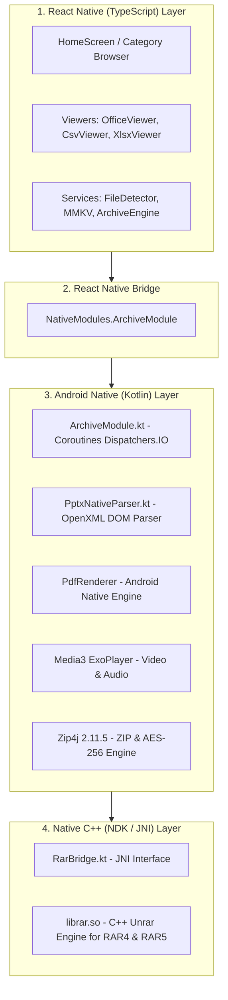

# Universal File Viewer — Architecture & Tech Stack Guide

> **Document Version:** 1.0  
> **Target App:** `Universal File Viewer (ufv_rn_poc)`  
> **Architecture:** Offline-First Hybrid (React Native + Android Kotlin + C++ NDK)  
> **Platform Tested:** Android (tested on physical device Realme 12 5G / Android 16)

---

## 1. High-Level Architectural Overview

Is application ko **3-Tier Hybrid Architecture** par banaya gaya hai taaki UI smooth aur responsive rahe, aur heavy file processing (jaise ZIP/RAR decompression, PDF rendering, aur PPTX OpenXML parsing) bina app freeze kiye background threads par native speed se chale.

---

## 2. Tech Stack: Kaunsi Library Kahan Aur Kyun Use Hui?

### A. React Native (TypeScript) — Frontend & UI Layer
* **Location:** `ufv_rn_poc/src/`
* **Zimmedari:** Screen navigation, file lists, user interactions, responsive layouts, modals, aur lightweight renderers.

| Library / Module | Kahan Use Hua? | Kyun Use Hua? (Reason) |
| :--- | :--- | :--- |
| **`react-native` (0.76.5)** | Pura UI Shell | Cross-platform UI components (`FlatList`, `ScrollView`, `Text`, `Image`, `View`). |
| **`react-native-webview`** | DOCX Rendering | Sandboxed local HTML/JS render karne ke liye (mammoth & docx-preview). |
| **`docx-preview` (v0.4.1)** | `OfficeViewer.tsx` | `.docx` files ko client-side CSS/HTML me high fidelity render karne ke liye. |
| **`mammoth` (v1.13.0)** | `OfficeViewer.tsx` | Agar docx-preview fail ho, toh fast HTML conversion fallback ke liye. |
| **`xlsx (SheetJS)`** | `XlsxViewer.tsx` | `.xlsx` aur `.xls` binary sheets ko parse karke multi-tab table grid banane ke liye. |
| **`papaparse` (v5.7.0)** | `CsvViewer.tsx` | Large `.csv` files (400,000+ rows) ko bina memory freeze ke stream aur paginate karne ke liye. |
| **Custom `MMKV.ts`** | `src/services/` | Recent files, favorites, aur last-read position (slide/page) instant persist karne ke liye. |
| **Custom `FileDetector.ts`** | `src/services/` | Sirf extension par rely kiye bina **Magic Bytes** se actual MIME format pehchanne ke liye. |

---

### B. Android Native (Kotlin) — Heavy Processing Layer
* **Location:** `ufv_rn_poc/android/app/src/main/java/com/ufv_rn_poc/archive/`
* **Zimmedari:** Heavy file decompression, native OS renderers, background multithreading (`Dispatchers.IO`), aur system intent integration.

| Component / Library | Kahan Use Hua? | Kaise Kaam Karta Hai? |
| :--- | :--- | :--- |
| **`ArchiveModule.kt`** | Native Bridge Module | React Native ke saath main bridge. Saare file methods async Coroutines me execute karta hai taaki main UI thread kabhi freeze na ho. |
| **`PptxNativeParser.kt`** | `archive/pptx/` | **Custom OpenXML Parser:** `presentation.xml`, `theme1.xml`, `slideLayout*.xml`, aur `slideMaster*.xml` ko padhkar background colors, non-placeholder shapes, fonts, aur normalized coordinates (0..1) nikalta hai. |
| **`net.lingala.zip4j:zip4j:2.11.5`** | `build.gradle` (Android) | Pure Java/Kotlin ZIP engine. Standard ZIP, password-protected ZIP (ZipCrypto), aur modern **AES-256** encryption ko unlock karta hai. |
| **`android.graphics.pdf.PdfRenderer`** | Android Framework Built-in | Google ka native Android PDF engine. PDF pages ko render karta hai zero third-party SDK dependencies ke saath. |
| **`androidx.media3:media3-exoplayer`** | `build.gradle` (Android) | Google Media3 ExoPlayer. Hardware-accelerated video playback (MP4, MKV, AVI, WebM) aur audio tracks handle karta hai. |
| **Android Storage Access Framework (SAF)** | `ArchiveModule.kt` | Device ki internal storage, SD Card, aur Downloads se secure local file picking handle karta hai. |

---

### C. C++ Native (NDK / JNI) — High Performance Low-Level Layer
* **Location:** `ufv_rn_poc/android/app/src/main/jniLibs/` & `RarBridge.kt`
* **Zimmedari:** Proprietary RAR algorithms (RAR4 & RAR5) ko C++ speed par extract karna.

| Component | Kahan Use Hua? | Kaise Kaam Karta Hai? |
| :--- | :--- | :--- |
| **`librar.so`** (C++ Binary) | `jniLibs/` (`arm64-v8a`, `armeabi-v7a`, `x86`, `x86_64`) | Alexander Roshal ka official UnRAR source code compiled into shared native libraries (`.so`). |
| **`RarBridge.kt` (JNI)** | `archive/RarBridge.kt` | Java Native Interface (JNI) jo Kotlin se C++ functions (`unrarOpen`, `unrarList`, `unrarExtractFile`) ko direct call karta hai. Solid archives aur encrypted headers ko support karta hai. |

---

## 3. Har Format Ko Kaise Handle Kiya Gaya Hai? (Detailed Pipeline)

### 1. PPTX (PowerPoint Presentations)
* **Problem:** WebViews modern Android par `file:///android_asset/` security policy ki wajah se block ho rahe the aur app freeze ho rahi thi.
* **Solution (Two-Phase Native Engine):**
  1. **Phase 1 (Kotlin Parser - `PptxNativeParser.kt`):**
     - PPTX zip archive se `ppt/presentation.xml` padh kar slide dimensions (EMUs) aur actual presentation order nikalta hai.
     - `theme1.xml` aur master `clrMap` se colors resolve karta hai (`srgbClr`, `schemeClr`, `lumMod`, `lumOff`).
     - Layout aur Master se missing placeholder coordinates aur styles inherit karta hai.
     - Embedded high-res images ko lazy extract karke local cache me save karta hai.
     - JSON structure return karta hai jisme har element ke coordinates normalized hote hain (`x: 0..1, y: 0..1`).
  2. **Phase 2 (React Native Presentation Deck - `OfficeViewer.tsx`):**
     - Exact 16:9 container banata hai jo portrait aur landscape dono me scale hota hai.
     - Exact background render karta hai (Slide 1: `#0B2F33`, Slide 2: `#FFFFFF`).
     - Geometric shapes (`ellipse`, `roundRect`, `rect`, `line`) render karta hai.
     - Text typography: Scaled font sizes, weights (Bold/Italic), underline, aur exact theme colors.
     - User controls: Zoom controls (100% se 250%) aur `🎨 Deck View` (Original layout) vs `📑 Cards View` (Simple reading) toggle button.

### 2. DOCX (Word Documents)
* React Native `OfficeViewer.tsx` file ko local storage se binary format me padhta hai.
* WebView me sandboxed offline template ke zariye `docx-preview.min.js` run hota hai jo tables, headers, footers, aur images ko exact Word layout me render karta hai.
* Agar complex XML structure ho, toh automated fallback `mammoth.browser.min.js` plain semantic HTML render kar deta hai.

### 3. PDF (Portable Document Format)
* `PdfViewer.tsx` Native Android `ArchiveModule` ko call karta hai.
* Android ka built-in `PdfRenderer` hardware level par page ko render karke memory-safe Bitmap banata hai.
* Horizontal/vertical paging, page counter (`Page X of Y`), aur MMKV se last-read page position resume hoti hai.

### 4. ZIP Archives (Compressed Folders)
* `ZipViewerScreen.tsx` aur `ArchiveModule.kt` milkar kaam karte hain.
* **Zip4j** use karke archive ko poora extract kiye bina andar ki file tree (nested folders) browse hoti hai.
* **Encrypted ZIP**: Password prompt aane par user password enter karta hai; Zip4j **AES-256** ya ZipCrypto se us single file ko on-the-fly extract karke relevant viewer me open kar deta hai.
* **Security**: Zip-bomb guard (compression ratio check) aur 2,500 file capping lagayi gayi hai taaki memory crash na ho.

### 5. RAR Archives (RAR4 & RAR5)
* `RarViewerScreen.tsx` native C++ `librar.so` ko `RarBridge.kt` ke through call karta hai.
* Solid RARs aur header-encrypted RARs bina kisi third-party external app ke direct phone par unlock hote hain.

### 6. XLSX & CSV (Spreadsheets)
* **XLSX**: `SheetJS (xlsx)` library workbook ke sheets ko parse karti hai aur custom scrollable grid banati hai jisme column headers (A, B, C...) aur row numbers dikhte hain.
* **CSV**: `PapaParse` library stream reader use karti hai taaki 30MB+ aur 400,000+ rows waali CSV files phone ki RAM ko exceed kiye bina smoothly paginate ho sakein.

### 7. Audio & Video (Media Playback)
* **Video**: Google Media3 ExoPlayer (`MediaViewer.tsx`) hardware codecs use karta hai jisse 1080p aur 4K videos smooth chalti hain bina phone heat hue.
* **Audio**: `AudioPlaybackService.ts` persistent background player support karta hai jo doosri screens par navigate karne par bhi floating mini-player bar me play hota rehta hai.

### 8. Text, Code & Large Logs
* `TextViewer.tsx` UTF-8 / ASCII encoding auto-detect karke line numbers, monospace font, aur real-time keyword search support karta hai.

---

## 4. Key Security & Performance Safeguards

1. **100% Offline & Zero-Network:**
   - App me koi external API call ya tracking server nahi hai. Saare files device ki storage me locally process hote hain.
2. **Zip-Bomb & Directory Traversal Protection:**
   - Unpacking ke waqt relative paths (`../`) sanitize kiye jaate hain taaki koi malicious file system directories me escape na kar sake.
3. **Memory Safety & Streaming:**
   - Large archives ke liye 2,500 file safety threshold indicator lagaya gaya hai.
   - Images aur PDFs downsampled bitmaps me load hote hain taaki low-end devices par out-of-memory (OOM) error na aaye.

---

## 5. Summary Matrix (Cheat Sheet)

| Format Category | File Extensions | Engine / Library | Layer |
| :--- | :--- | :--- | :--- |
| **PDF** | `.pdf` | Android `PdfRenderer` | Android Native (Kotlin) |
| **Word** | `.docx` | `docx-preview` + `mammoth` | React Native (WebView) |
| **Presentation** | `.pptx` | Custom OpenXML Parser + Deck UI | Kotlin (Parser) + React Native (UI) |
| **Spreadsheets** | `.xlsx`, `.xls` | `xlsx (SheetJS)` | React Native (JS) |
| **Delimited Data**| `.csv`, `.tsv` | `PapaParse` (Streaming) | React Native (JS) |
| **ZIP Archives** | `.zip` | `Zip4j 2.11.5` (AES-256) | Android Native (Kotlin) |
| **RAR Archives** | `.rar` | `librar.so` (C++ UnRAR) | Native C++ (NDK / JNI) |
| **Video** | `.mp4`, `.mkv`, `.avi`, `.webm` | Google `Media3 ExoPlayer` | Android Native (Kotlin) |
| **Audio** | `.mp3`, `.m4a`, `.wav`, `.flac` | Android MediaPlayer / Media3 | Android Native (Kotlin) |
| **Images** | `.jpg`, `.png`, `.webp`, `.gif` | React Native `<Image>` + PinchZoom | React Native (JS) |
| **Structured Text**| `.txt`, `.json`, `.xml`, `.log`| Virtualized Text Chunk Reader | React Native (JS) |
| **State & Cache** | Recents, Favorites, Positions | Custom `MMKV` Engine | Local Storage / Key-Value |

