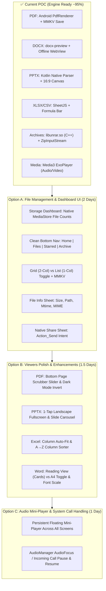

# 🚀 Universal File Viewer: Pending Features Implementation Plan (Phase 1 P0)

This implementation plan bridges the gap between the **Current POC Engine (90–95% Complete)** and the **Full Master PRD & Development Guide (Consumer UI & Viewer Polish)**.

---

## 📊 1. Current State vs Target Roadmap



---

## 🛠️ Detailed Breakdown by Option

### 🔹 OPTION A: File Management & Consumer UI (Google Files Experience)
**Priority: P0 | Estimated Timeline: 2 Days**

#### 1. Native MediaStore Fast Storage Scanner (`ArchiveModule.kt`)
* **Problem:** Currently `HomeScreen` only filters `recentFiles` in MMKV. There is no real count of documents on device storage. Traversing `/sdcard` in JS via RNFS freezes the UI.
* **Solution:** Add native Kotlin `@ReactMethod fun getStorageDashboardCounts(promise: Promise)` and `@ReactMethod fun queryCategoryFiles(category: String, promise: Promise)`.
  - Queries Android SQLite `MediaStore.Files.getContentUri("external")`.
  - Filters by MIME types and file extensions (`pdf`, `docx`, `xlsx`, `pptx`, `zip`, `rar`, `mp3`, `mp4`, `jpg`, etc.).
  - Executes in IO thread (`Dispatchers.IO`) in **<80ms**.
  - Returns:
    ```json
    {
      "pdf": { "count": 42, "totalBytes": 134217728 },
      "word": { "count": 18, "totalBytes": 45000000 },
      "excel": { "count": 12, "totalBytes": 18000000 },
      "pptx": { "count": 9, "totalBytes": 98000000 },
      "archives": { "count": 27, "totalBytes": 450000000 },
      "audio": { "count": 64, "totalBytes": 320000000 },
      "video": { "count": 15, "totalBytes": 1500000000 }
    }
    ```

#### 2. Storage Dashboard & Category Grid (`HomeScreen.tsx`)
* Replace debug headers with a sleek Google Files-style Dashboard:
  - **Storage Bar:** Internal Storage used / total indicator.
  - **Category Cards (2x4 Grid):**
    - 📕 PDFs (`42 files • 128 MB`)
    - 📘 Word Docs (`18 files • 43 MB`)
    - 📗 Spreadsheets (`12 files • 17 MB`)
    - 📙 Presentations (`9 files • 93 MB`)
    - 🗜️ Archives (`27 files • 429 MB`)
    - 🎵 Audio (`64 files • 305 MB`)
    - 🎬 Videos (`15 files • 1.4 GB`)
  - **Continue Reading Section:** Last opened documents with page / time progress pill.
  - **Recent Files Section:** Horizontally scrollable or compact list.

#### 3. Grid vs List View Toggle (`FolderBrowserScreen.tsx` & `HomeScreen.tsx`)
* Header toggle button (`⊞ Grid` / `☰ List`).
* Stored in MMKV: `MMKV.setSetting('view_mode', 'grid' | 'list')`.
* **List View:** Standard `FileCard` with name, size, date, badge, star.
* **Grid View:** 2-column responsive cards with large format icon, centered thumbnail placeholder, title, and compact meta.

#### 4. File Info Modal (`FileDetailsModal.tsx`)
* Bottom-sheet dialog triggered by long-press or ℹ️ icon:
  - File Name & Extension Badge
  - File Size (formatted in B, KB, MB, GB)
  - Full File Path (with 📋 1-Tap Copy Path button)
  - Date Modified (Formatted `DD MMM YYYY, hh:mm A`)
  - MIME Type (e.g., `application/vnd.openxmlformats-officedocument.wordprocessingml.document`)
  - Actions: **Open**, **Share 📤**, **Star/Unstar ⭐**, **Delete 🗑️**

#### 5. Native Share Sheet Integration (`ArchiveEngine.ts`)
* Wire `ArchiveModule.shareFile(filePath, mimeType)`:
  - Available on `FileCard` three-dot menu.
  - Top header icon in all viewers (`PdfViewer`, `OfficeViewer`, `XlsxViewer`, `MediaViewer`, `RarViewerScreen`, `ZipViewerScreen`).
  - Native Android intent chooser (`Intent.ACTION_SEND` with `FileProvider` URI).

---

### 🔹 OPTION B: Viewers Polish & Reading Experience
**Priority: P1 | Estimated Timeline: 1.5 Days**

#### 1. PDF Viewer Polish (`PdfViewer.tsx`)
* **Bottom Page Scrubber Slider:**
  - Interactive slider at the bottom (1 to N) with live page bubble indicator.
  - Eliminates the need to open a modal dialog just to jump 5 pages.
* **Night / Dark Reading Mode:**
  - Inverted canvas filter / high-contrast dark palette toggle (`#121212` background, white inverted text/canvas) for comfortable night reading.

#### 2. PPTX Viewer Enhancements (`OfficeViewer.tsx`)
* **1-Tap Landscape Fullscreen:**
  - Auto-orient to landscape via `ScreenOrientation` lock, hiding app bars for immersive presentation mode.
* **Bottom Slide Thumbnails Tray:**
  - Horizontal slide thumbnail carousel at the bottom for instant slide scrubbing and preview.

#### 3. Excel & CSV Enhancements (`XlsxViewer.tsx`)
* **Column Auto-Fit on Double Tap:**
  - Double tapping column header measures maximum text length in column and snaps column width to fit content.
* **Column Sorter (A→Z / Z→A):**
  - Tap column header sorting arrow to sort table ascending/descending.

#### 4. Word Docs Reflow (`OfficeViewer.tsx`)
* **Reading View vs A4 Page Mode:**
  - Toggle between fixed A4 layout (paginated) and Reflowed Mobile Reading View (responsive text flow).
* **Font Scaling Stepper:**
  - Quick `A-` / `A+` buttons to scale typography (80% to 150%) in reading view.

---

### 🔹 OPTION C: Audio Mini-Player & System Call Handling
**Priority: P1 | Estimated Timeline: 1 Day**

#### 1. Persistent Floating Mini-Player
* Dock `AudioMiniPlayer.tsx` above Bottom Navigation Dock across all root screens.
* Smooth slide-up transition when audio is playing, tap opens full player modal.

#### 2. Incoming Call & Audio Focus Handling (`Media3PlaybackModule.kt` / `ArchiveModule.kt`)
* Register `AudioManager.OnAudioFocusChangeListener`.
* When phone receives an incoming call (`AUDIOFOCUS_LOSS_TRANSIENT`):
  - Automatically pause playback.
  - Save playback position.
* When call ends (`AUDIOFOCUS_GAIN`):
  - Resume playback cleanly.

---

## 📅 Roadmap & Execution Phases

| Phase | Module | Focus Areas | Deliverables |
|---|---|---|---|
| **Phase 1 (Option A)** | Core File Management UI | Bottom Nav, MediaStore Scanner, Dashboard Tiles, Grid/List, Share, Info Modal | Google Files-grade App experience |
| **Phase 2 (Option B)** | Viewers Polish | PDF slider & Dark mode, PPTX landscape tray, Excel sort & auto-fit, Word reflow | Polished offline reader |
| **Phase 3 (Option C)** | Audio & System Polish | Global Floating Mini-Player, Call interruption auto-pause | Spotify-like audio UX |
| **Phase 4 (Later)** | Monetization & Backend | AdMob, In-App Billing, Cloud Sync (Phase 3 of Master PRD) | Commercialization |

---

## 🎯 Next Immediate Step: Option A Execution

To kick off **Option A**, we can immediately implement:
1. Native `MediaStore` scanner in Kotlin (`ArchiveModule.kt`).
2. Google Files-style Dashboard with dynamic counts in `HomeScreen.tsx`.
3. Grid/List view toggle with 2-column layout in `FileCard.tsx` and `FolderBrowserScreen.tsx`.
4. File Info Sheet & Native Share button across the app.

