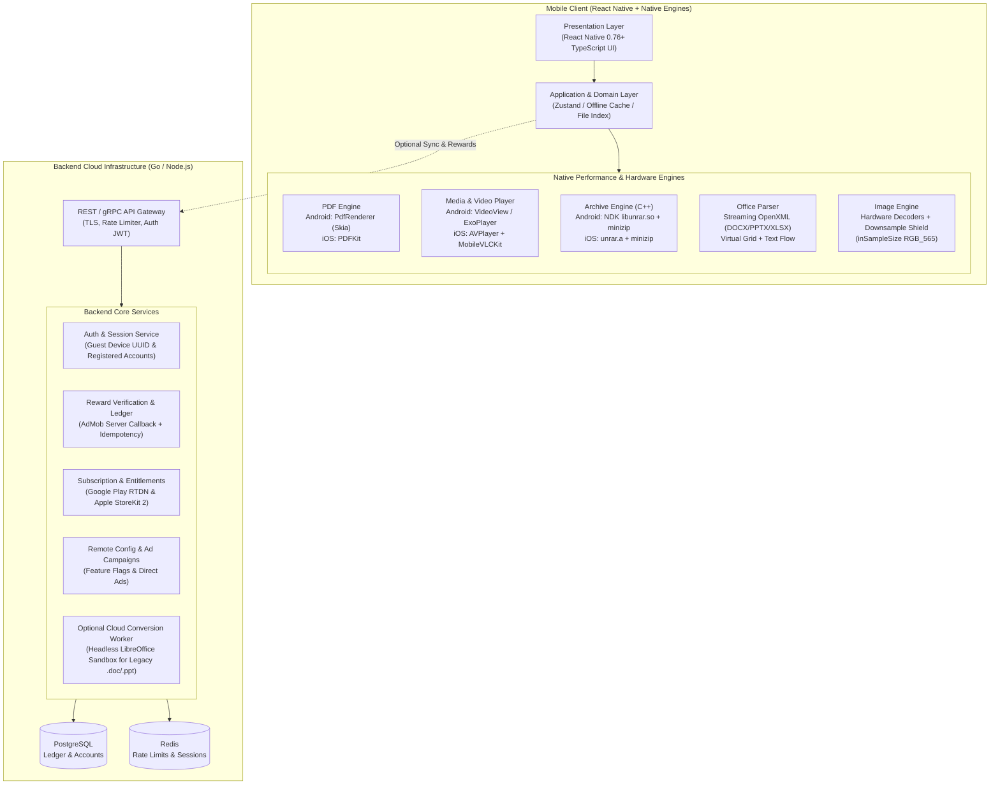

# Universal File Viewer & Review Platform
## Master Technical Implementation & Engineering Blueprint

**Document ID:** `UFV-TECH-GUIDE-001`  
**Governing Documents:**  
1. *Universal File Viewer - Master Product Requirements Document (`Master PRD`)*  
2. *Universal File Review - Development Guide (`UFV-SDRD-001`)*  
**Architecture Style:** Local-First Mobile Application (React Native + Native C++/NDK + iOS Bridges) + Scalable Cloud Services (Node.js/Go + PostgreSQL + Redis)  
**Target Platforms:** Android (API 26+), iOS (iOS 15+), Server (Docker / Kubernetes / AWS)

---

## 1. System Architecture Overview



---

## 2. Core Architectural Principles (From Master PRD & SDRD)

1. **Local-First & Offline-Default**: Core utility (opening, reading, watching, listening, and extracting files) **must work 100% offline** without network access or mandatory user login.
2. **Zero-Trust Input Boundary**: File extensions are **never trusted**. File identity is established strictly via **magic byte sniffing** (hex signatures).
3. **Defensive Memory & Execution Isolation**:
   - Heavy parsing (C++ unrar, zip decompression, 100k-row spreadsheet XML) runs on dedicated background native worker threads, **never blocking the UI thread**.
   - Archives enforce **Zip-Slip prevention**, **100:1 decompression bomb expansion limits**, and **10,000 entry count ceilings**.
   - Extreme bitmaps (10,000×8,000) are automatically downsampled using `inSampleSize` in `RGB_565` color format.
4. **Commercial Safeguards (Utility Over Ads)**:
   - Advertisements must never block a file from opening.
   - Rewarded credits are authoritatively validated **server-side** with an immutable financial ledger.
   - Client is never allowed to modify its own credits or subscription entitlements.

---

## 3. Native File Engines (Implementation Details)

### 3.1 Native Video & Audio Player Engine

To achieve **TTFF $\le 350\text{ms}$** and **Seek Latency $\le 200\text{ms}$** without external bundle bloat:

* **Android Implementation:**
  * Uses `android.widget.VideoView` and `android.media.MediaPlayer` (`MediaCodec`).
  * Measures TTFF via `MediaPlayer.MEDIA_INFO_VIDEO_RENDERING_START`.
  * Measures Seek 50% via `MediaPlayer.setOnSeekCompleteListener`.
  * Background Audio: Hooks into Android `MediaSessionCompat` and `AudioManager.requestAudioFocus` to support lockscreen controls and audio ducking during phone calls.
* **iOS Implementation:**
  * Standard `.mp4`, `.mov`, `.m4v`: Native Apple `AVPlayer` with `AVPlayerViewController`.
  * Matroska `.mkv` & `.avi`: Apple `AVPlayer` natively rejects MKV. Implement a native bridge to `MobileVLCKit` or `libmpv` (compiled as static C library) so MKV plays with zero transcoding.

---

### 3.2 High-Performance C++ Archive Engine (ZIP & RAR)

To eliminate the 7-minute bottleneck on massive archives (`new.zip` / `100mb.rar`), archive extraction is moved entirely into **C++ Native Code (NDK on Android, C++ static library on iOS)**:

#### Android NDK CMake Setup (`android/app/src/main/cpp/CMakeLists.txt`)
```cmake
cmake_minimum_required(VERSION 3.18.1)
project(ufv_native_archive)

# Add official unrar source files from RARLab
file(GLOB UNRAR_SRC
    unrar/*.cpp
)
# Exclude standalone main.cpp
list(REMOVE_ITEM UNRAR_SRC "${CMAKE_CURRENT_SOURCE_DIR}/unrar/main.cpp")

add_library(unrar_native SHARED
    ${UNRAR_SRC}
    unrar-jni.cpp
)

target_include_directories(unrar_native PRIVATE
    unrar
)

target_link_libraries(unrar_native
    android
    log
)
```

---

### 3.3 Document & Spreadsheet Engine

1. **PDF Rendering**:
   * Android: Android AOSP native `PdfRenderer` hardware-rendered to `Bitmap.Config.ARGB_8888` surfaces. Implements LRU memory cache for rendered page tiles (max 10 cached pages).
   * iOS: Apple `PDFKit` (`PDFView`) with vector zoom and native pinch-to-zoom.
2. **Office Documents (DOCX / PPTX / XLSX)**:
   * **DOCX**: Streaming OpenXML parser extracting paragraphs, headings (`w:p`), tables (`w:tbl`), and bold/italic runs (`w:r`). Preserves document flow with an honest **PARTIAL** badge.
   * **PPTX**: Slide-by-slide XML reader extracting headings and text shapes into responsive slide viewports with thumbnail strip navigation.
   * **XLSX**: Virtualized FlatList table reading `xl/worksheets/sheet1.xml` with **stream-capping** (max 512 KB preview chunks) to prevent Dalvik OutOfMemoryError on 100k+ row workbooks.
3. **Legacy OLE Documents (`.doc`, `.xls`, `.ppt`)**:
   * Binary OLE2 compound files are identified via magic bytes `D0 CF 11 E0 A1 B1 1A E1`.
   * **Local Mode:** Display format metadata and honest notice: *"Legacy Microsoft Office binary format requires modern conversion"*.
   * **Connected Mode (Optional Cloud Converter):** Allow user to tap *"Convert to PDF with Cloud Converter"*, which routes through your backend worker to render via headless LibreOffice.

---

## 4. Backend Cloud Architecture & Database Schema

The backend is built as a **lightweight, stateless REST API in Go or Node.js (NestJS / Fastify)** backed by PostgreSQL and Redis.

### 4.1 Server-Side Rewarded Ad Verification API

To prevent ad fraud, credits are **never awarded client-side**. The advertising provider (AdMob / AppLovin) hits a server-to-server webhook:

```
POST /api/v1/rewards/verify-callback
Headers:
  X-AdMob-Signature: <HMAC-SHA256 signature>
Body:
{
  "ad_network": "admob",
  "reward_item": "premium_credit",
  "reward_amount": 10,
  "user_id": "usr_94b8a21e-76dc",
  "transaction_id": "tx_admob_1793264891",
  "timestamp": 1793264891
}
```

#### Backend Verification Flow:
1. Validate HMAC signature against AdMob Public Key.
2. Check `transaction_id` against `REWARD_LEDGER` table using unique constraint. If already processed, return `HTTP 200 { "status": "ALREADY_PROCESSED" }` (Idempotent).
3. Insert ledger entry inside a database transaction:
   ```sql
   INSERT INTO reward_ledger (id, user_id, transaction_id, credit_amount, idempotency_key, created_at)
   VALUES (gen_random_uuid(), $1, $2, $3, $4, NOW())
   ON CONFLICT (transaction_id) DO NOTHING;
   ```
4. Emit real-time WebSocket / SSE update to mobile client to increment wallet UI.

---

### 4.2 In-App Purchase & Subscription Verification

* **Google Play Billing (Android)**:
  * Backend uses Google Play Developer API (`purchases.subscriptionsv2.get`).
  * Subscribes to Google Cloud Pub/Sub Real-Time Developer Notifications (RTDN).
  * Automatically handles renewals, grace periods, and cancellations.
* **Apple StoreKit 2 (iOS)**:
  * Uses Apple App Store Server API with signed JWS (JSON Web Signatures).
  * Subscribes to App Store Server Notifications v2 for refunds and renewals.
* **Offline Entitlement Caching**:
  * When online, backend returns signed JWT with `exp` date.
  * Mobile client stores token in OS Keychain / EncryptedSharedPreferences.
  * Offline user retains ad-free viewing until token expiry without needing network calls.

---

## 5. Security Engineering & Hardening

| Attack Vector | Vulnerability | Defense Implemented |
| :--- | :--- | :--- |
| **Path Traversal** | Malicious archive extracting to `../../system/` | Canonical path validation: abort and recursively delete temporary extract folder if path does not start with sandbox destination. |
| **Decompression Bomb** | 42 KB archive expanding to 4.5 Petabytes | **100:1 ratio abort** and **2 GB total size abort** enforced at streaming chunk level. |
| **Descriptor Exhaustion** | 50,000 empty files crashing filesystem table | Max **10,000 entry ceiling** check before extraction begins. |
| **XXE Injection** | Malicious XML file executing external entities | Disable external DTDs in XML parsers (`setFeature("http://apache.org/xml/features/disallow-doctype-decl", true)`). |
| **Memory Exhaustion (OOM)** | 100k-row spreadsheet XML (43MB+) allocating 134MB String | Stream-cap preview to 512 KB, catch `Throwable` (not just `Exception`), and enable `android:largeHeap="true"`. |
| **Reward Fraud** | Modifying SQLite / SharedPreferences credits | Cryptographic server-side ledger with device UUID signatures. |

---

## 6. Phase-by-Phase Development Roadmap

### Phase 1: Native Core & File Detection Engine (Weeks 1–3)
* Setup React Native 0.76+ New Architecture bare project.
* Implement pure magic-byte `FileDetector.ts` (zero extension reliance).
* Implement Android hardware `PdfRenderer` and `VideoView` native modules.
* Implement ZIP streaming extractor with Zip-Slip and bomb shields.

### Phase 2: Native C++ Engine & iOS Equivalents (Weeks 4–6)
* Setup Android NDK CMake with official RARLab `unrarsrc` (`libunrar.so`).
* Setup iOS static library `unrar.a` with Objective-C++ bridge.
* Integrate iOS `MobileVLCKit` / `libmpv` for MKV/AVI playback.
* Implement OpenXML text/slide streaming parsers for DOCX/PPTX/XLSX.

### Phase 3: Backend Services & API Gateway (Weeks 7–9)
* Deploy containerized Go / Node.js API with PostgreSQL and Redis.
* Implement server-to-server Rewarded Ad verification endpoint with HMAC signatures.
* Implement Google Play Billing & Apple StoreKit 2 webhook verification.
* Configure remote feature flag and first-party campaign service.

### Phase 4: Monetization UI & Safeguard Integration (Weeks 10–12)
* Implement Rewarded Ad Wallet UI with real-time balance sync.
* Implement Subscription purchase screens with offline signed entitlement tokens.
* Enforce UX Safeguards: Zero interruptive ads during reading or file playback.

### Phase 5: QA Corpus Testing & Hardening (Weeks 13–15)
* Execute full 238-file test corpus across Pixel and iPhone test devices.
* Run 20x open/close memory leak stress tests.
* Ensure all pass/fail conditions meet Master SDRD Section 18 criteria.

### Phase 6: App Store Submission & Production Launch (Week 16)
* Complete Google Play Data Safety and Apple Privacy Nutrition labels.
* Build release AAB and iOS IPA with stripped debug symbols.
* Production release handover with architecture documentation and source control keys.

