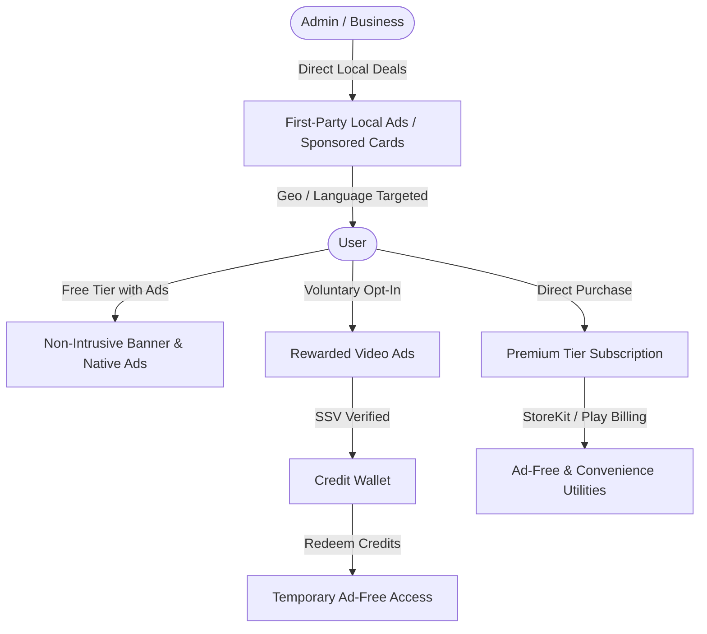
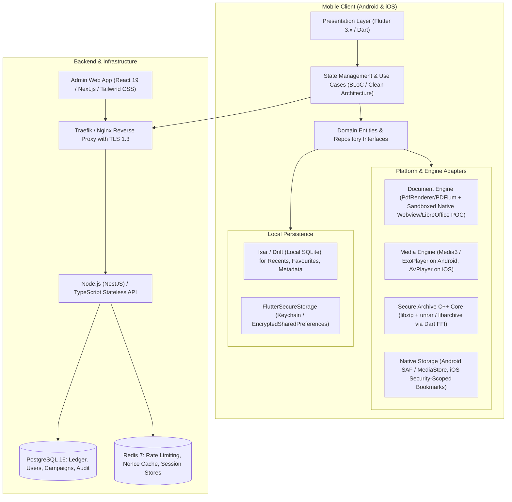
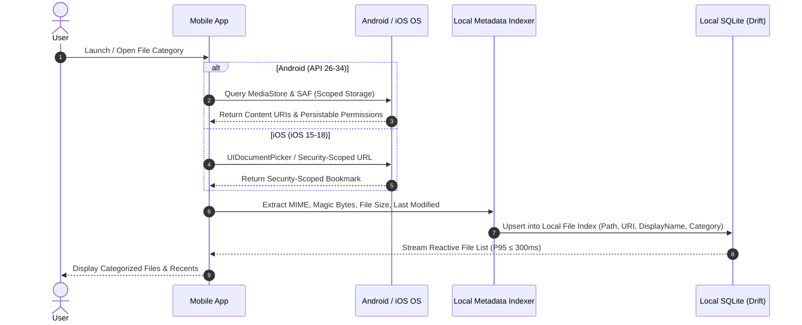
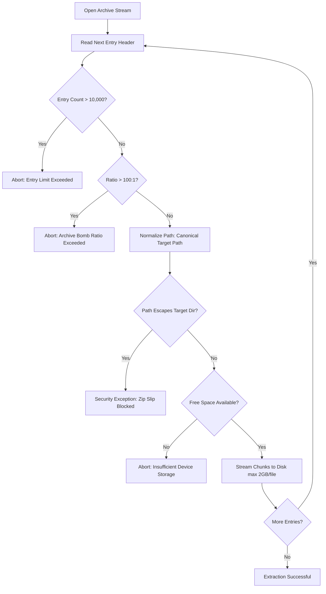
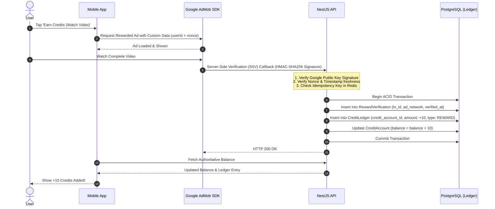
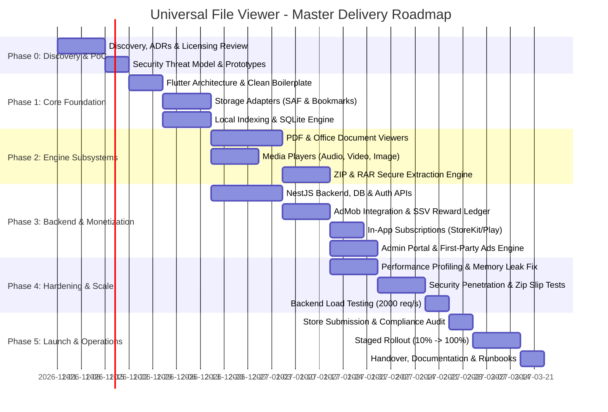
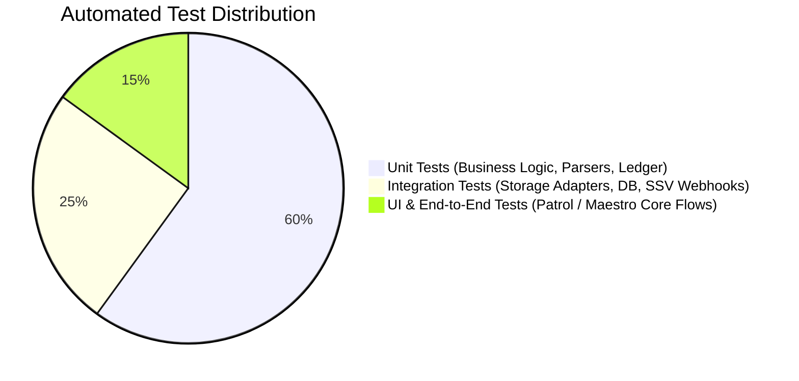
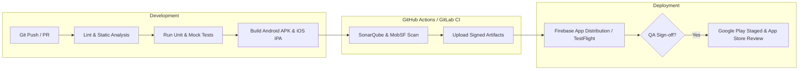

# MASTER IMPLEMENTATION PLAN
## Universal File Viewer, Reader, Media Player & Archive Manager (UFV)

---

**Document ID:** `UFV-IMP-001`  
**Version:** `1.0.0 (Production Master)`  
**Baseline Documents:**  
1. *Universal File Viewer - Master Product Requirements Document (PRD)*  
2. *Universal File Review - Development Guide, Technical Architecture, QA, Security & Production Readiness Specification (UFV-SDRD-001)*  
**Target Platforms:** Android (API 26+) & iOS (iOS 15.0+)  
**Primary Launch Market:** India (with global scalability)  
**Execution Model:** Professional External Development & UI/UX Agency with Strict Product Owner Sign-off  

---

## 1. Executive Summary & Project Charter

### 1.1 Objective & Value Proposition
The Universal File Viewer (UFV) is designed to be the definitive **all-in-one mobile utility** for Indian consumers, professionals, and students. It eliminates the need to install separate, fragmented applications for viewing PDFs, reading Office documents, playing audio/video, displaying images, or inspecting and extracting ZIP and RAR archives.

### 1.2 Core Architectural Axiom: Local-First File Processing
* **100% Local File Execution:** All file opening, parsing, reading, media rendering, and archive extractions take place entirely on the user's physical device.
* **Zero Cloud Content Dependency:** Files are **never** uploaded to external servers for viewing or extraction. Network unavailability must never prevent a user from opening local files.
* **Strict Separation of Concerns:** Server infrastructure exists strictly for non-file utility tasks: optional identity, reward verification, credit ledger management, subscription entitlement sync, and first-party local advertisement serving.

### 1.3 Monetization Triangle


---

## 2. Scope Boundaries & Traceability Matrix

### 2.1 Scope Classification (P0 / P1 vs. Exclusions)

| Capability Domain | Phase 1 Mandatory (P0 / P1) | Future Roadmap (Explicitly Excluded from Phase 1) |
| :--- | :--- | :--- |
| **Document Viewing** | PDF, DOCX, DOC, XLS, XLSX, CSV, PPT, PPTX, TXT, RTF, JSON, XML, LOG. Search & text selection where feasible. | Full Office editing, formula recalculation, OCR, scanned document recognition, document conversion. |
| **Media Playback** | Images: JPG, JPEG, PNG, WebP, GIF (anim), BMP. Audio: MP3, AAC, M4A, WAV, FLAC, OGG. Video: MP4, MOV, MKV, WebM, AVI. Audio focus, background playback. | Speech-to-text, media transcription, video editing, cloud streaming. |
| **Archive Subsystem** | **Mandatory:** ZIP and RAR (v4 & v5). In-archive tree browsing without extraction, selective extraction, cancel, progress bar, path normalization (Zip Slip prevention), archive bomb protection. | TAR, GZIP, 7Z, BZ2, creating password-protected archives, multi-volume archive creation. |
| **Storage & OS** | Android Scoped Storage / SAF (`ACTION_OPEN_DOCUMENT`, `ACTION_VIEW`), iOS `UIDocumentPickerViewController`, Security-Scoped Bookmarks, Share Sheets. Recent files, favourites, categories. | Cloud drive bi-directional sync (Google Drive / iCloud / Dropbox auto-backup). |
| **Monetization** | AdMob (Home banners, native cards), Rewarded Ads with Server-Side Verification (SSV), Credit Wallet & Ledger, Subscriptions (Play Billing / StoreKit 2), First-party localized ad cards. | Self-service advertiser self-registration portal, bidding exchange, programmatic mediation waterfall complexity beyond baseline. |
| **Backend & Admin** | Lightweight REST/GraphQL APIs, Auth (Guest / Phone OTP / Social), SSV webhook, Ledger, Subscriptions, Admin Web Portal (RBAC, campaign manager, remote config kill-switches, audit trail). | Real-time social feeds, community comments, multi-region database sharding. |

### 2.2 Traceability & Defect Severity Framework

Any defect discovered during CI/CD, QA, or security auditing must be classified under these strict criteria:

* **Severity 0 (Critical - Immediate Block):** Active vulnerability exploitation, remote code execution (RCE) via malicious file parser, Zip Slip directory escape, arbitrary file overwrite, financial credit ledger corruption, system-wide crash.
* **Severity 1 (High - Release Blocker):** Repeatable crash in core viewing/playback/extraction journeys, reward verification bypass / fraud, storage permission denial deadlock, memory leak causing OS termination on 50MB PDF.
* **Severity 2 (Medium - Target Sprint Resolution):** Layout glitch on specific aspect ratios, non-blocking edge-case parser errors for uncommon DOC formatting, minor localization string clipping.
* **Severity 3 (Low - Deferrable with Approval):** Subtle UI micro-animation inconsistency, cosmetic padding mismatch in settings.

---

## 3. Technology Stack & Architecture Decision Records (ADRs)

### 3.1 Mobile Architecture & Stack Selection



#### ADR-001: Mobile Core Framework — Flutter vs. React Native vs. 100% Native
* **Decision:** **Flutter (3.24+ / Dart 3.5+)** with native C/C++ FFI bindings for low-level archive processing, coupled with native Kotlin/Swift platform views for high-performance rendering.
* **Rationale:** 
  1. Delivers 60 FPS pixel-perfect consistency across Android and iOS on budget and flagship devices.
  2. Direct C/C++ FFI enables high-speed uncompressed memory streaming for archive inspection and extraction without bridge marshaling overhead.
  3. First-class Google Mobile Ads (AdMob) SDK and In-App Purchase plugins maintained directly by Google.
  4. PoC required in Phase 0 to validate memory footprint on 100MB+ PDF documents.

#### ADR-002: Secure Archive Handling (ZIP & RAR)
* **Engine:** Pre-compiled C/C++ native libraries (`libzip` for ZIP, approved open-source `unrar` / `libarchive` decoding engine) bound via Dart FFI.
* **Security Controls:** Sandboxed extraction worker isolate, pre-read header validation, path normalization against target sandbox root, dynamic compression ratio monitor.

#### ADR-003: Document & Office Rendering Strategy
* **PDF:** Native integration with Google PDFium (Android) and `PDFKit` (iOS) via texture rendering to prevent memory spikes.
* **Office Formats (DOCX, XLSX, PPTX):** Local OpenXML parsing to structured lightweight HTML/canvas representation rendered inside an offline, JavaScript-restricted, non-networked headless local Webview or native canvas renderer.
* **Structured Data (JSON, XML, LOG):** Virtualized viewport list (only renders visible lines) with UTF-8/Unicode streaming parser; prevents memory freeze on 20MB+ log files.

#### ADR-004: Backend & Database Architecture
* **Language & Framework:** **Node.js with NestJS (TypeScript)** — modular, enterprise-grade, strict dependency injection, auto-generated OpenAPI/Swagger documentation.
* **Primary Database:** **PostgreSQL 16** with strict ACID transactions, row-level locking for the credit ledger, and JSONB support for dynamic campaign targeting.
* **Cache & Rate-Limiting:** **Redis 7** for idempotency token validation, SSV transaction deduplication, and JWT blacklisting.

---

## 4. Subsystem Deep-Dive & Engineering Specifications

### 4.1 Storage & File Access Architecture



#### Android Platform Rules:
* Target API 34+ compliance.
* Must **not** request broad `MANAGE_EXTERNAL_STORAGE` permission unless strictly verified by Google Play policy as a file manager; default to Scoped Storage (`READ_MEDIA_IMAGES`, `READ_MEDIA_VIDEO`, `READ_MEDIA_AUDIO`) and Storage Access Framework (`ACTION_OPEN_DOCUMENT`, `ACTION_OPEN_DOCUMENT_TREE`) with `takePersistableUriPermission`.
* Handle external launch intents (`android.intent.action.VIEW`) with MIME validation and fallback sniffing.

#### iOS Platform Rules:
* Handle `UIDocumentPickerViewController` with `asCopy: false` for reading in-place via Security-Scoped Bookmarks (`startAccessingSecurityScopedResource()` and `stopAccessingSecurityScopedResource()` wrapped in guaranteed `try/finally` blocks).
* Declare UTI handlers in `Info.plist` for all target extensions.

---

### 4.2 ZIP & RAR Security Engineering



#### Zip Slip & Traversal Safeguards:
1. `entryName` is treated as **untrusted user input**.
2. Strip all drive letters (`C:\`), root prefixes (`/`), and normalize directory separators.
3. Compute target file path: `destinationDir.canonicalPath + File.separator + entryName`.
4. Enforce check: `targetPath.startsWith(destinationDir.canonicalPath)`. If `false`, throw `SecurityViolationException` immediately and halt.
5. Reject symbolic links pointing outside the extraction root.

#### Archive Bomb Protections:
* **Max Total Entries:** 10,000 files per archive.
* **Max Single Extracted File:** 2.0 GB.
* **Max Cumulative Extraction:** Configurable (e.g., 5.0 GB or remaining device storage minus 500MB safety margin).
* **Max Compression Ratio:** 100:1. Abort if compressed size is 1MB and uncompressed size exceeds 100MB.
* **Nesting Depth Limit:** Max 5 levels of directory nesting.

---

### 4.3 Rewarded Ads & Double-Entry Credit Ledger



#### Rewarded Ad Rules:
* **No Client-Side Authority:** Balance is **never** incremented locally without backend confirmation.
* **Server-Side Verification (SSV):** Cryptographic verification of AdMob callbacks using Google public keys.
* **Idempotency Guarantee:** Every transaction reference ID (`transaction_id`) is stored in a unique constraint database table. Duplicate webhook deliveries yield HTTP 200 without duplicate credit allocation.
* **Guest User Tracking:** Cryptographically random UUID stored in device secure storage (`Keychain` / `EncryptedSharedPreferences`), bound to guest ledger account. Supports seamless account upgrade/merging upon user registration.

---

### 4.4 Subscriptions & Entitlement Management

* **Integration Providers:** Native Google Play Billing Library (v7+) on Android, Apple StoreKit 2 on iOS (with RevenueCat or custom backend webhook validation).
* **Entitlement State Machine:**
  - `ACTIVE`: Verified receipt/token, expiration date in the future.
  - `GRACE_PERIOD`: Payment failed, store allows temporary access while retrying.
  - `EXPIRED`: Terminated, revert to free tier.
  - `REVOKED`: Chargeback / refund detected, immediately terminate entitlements.
* **Offline Entitlement Caching:**
  - Authoritative entitlement token signed with backend Ed25519 private key, stored in secure local storage.
  - Client validates signature locally with public key. Valid offline for max **72 hours** before requiring network sync.
  - Core local file reading is **never blocked** even if entitlement expired; user simply sees standard non-intrusive ads.

---

### 4.5 First-Party Local Sponsored Advertising Engine

```mermaid
graph LR
    subgraph AdminActions ["Admin Portal"]
        Create[Create Campaign] --> UploadCreative[Upload Assets & Copy]
        UploadCreative --> SetTargeting[Set City / State / Language / Budget]
        SetTargeting --> Approve[Publish Campaign]
    end

    subgraph ClientDelivery ["Mobile App Engine"]
        AppReq[Fetch Active Local Placements] --> Cache[Local SQLite Card Cache]
        Cache --> CheckLocation[Match Coarse Location / Language]
        CheckLocation --> RenderCard[Render Native Sponsored Card]
        RenderCard --> LogImpression[Queue Offline Impression]
        LogImpression --> BatchSync[Batch Sync Telemetry to API]
    end

    Approve --> AppReq
```



* **Targeting Precision:** Coarse geography only (State, Tier 1/2/3 City, Selected App Language). **Strictly no precise GPS permissions required** for privacy compliance.
* **Ad Placements:** Home screen native sponsored card, file category footer.
* **Prohibited Placements:** Inside reading documents, during video playback, blocking archive extraction prompts.

---

### 4.6 Privacy, Threat Modeling & DPDP Act 2023 Compliance

1. **Indian Digital Personal Data Protection (DPDP) Act 2023 Principles:**
   - **Data Minimization:** No personal file metadata, document names, or contents are sent to the backend.
   - **Consent Architecture:** Granular, unambiguous opt-in consent for optional accounts, analytics, and targeted advertising.
   - **Right to Erasure:** In-app one-click "Delete Account & Data" action executing full cascade purge in PostgreSQL within 24 hours.
2. **Threat Modeling & Mitigation:**
   - *Threat 1: Malformed PDF/DOCX Buffer Overflow in native parser.*  
     *Mitigation:* Render engines execute in isolated child processes/threads with strict memory caps. All parser exceptions caught gracefully; display "Unable to render file" rather than crashing the OS process.
   - *Threat 2: Zip Slip Directory Traversal.*  
     *Mitigation:* Enforce path canonicalization and verification before disk I/O.
   - *Threat 3: Ad Spoofing / Reward Verification Fraud.*  
     *Mitigation:* Client cannot award credits. All credits issued via AdMob SSV cryptographic callback to backend.
   - *Threat 4: Reverse Engineering / API Tampering.*  
     *Mitigation:* SSL/TLS 1.3 Pinning on backend APIs, App Check / SafetyNet / Play Integrity API integration, code obfuscation (ProGuard / R8 / Flutter symbol stripping).

---

## 5. Performance Budgets & Device Compatibility SLA

### 5.1 Performance Targets

| Operational Metric | Target SLA (P95) | Measurement Method & Device Profile |
| :--- | :--- | :--- |
| **Cold App Launch** | $\le 3.0$ seconds | App kill $\to$ Interactive Home Screen on Budget Reference Device (e.g., Redmi 9A / Samsung Galaxy A12) |
| **Warm App Launch** | $\le 1.5$ seconds | Background resume to Home Screen |
| **PDF First Page Render** | $\le 2.0$ seconds | Standard 50-page PDF document |
| **DOCX/XLSX Initial Open** | $\le 3.0$ seconds | Standard 10MB test file |
| **UI Touch Response** | $\le 200$ ms | Visual ripple / state change on tap |
| **File List Scrolling** | 60 FPS (zero stutter) | Scrolling 1,000 indexed files in browse view |
| **Memory Footprint** | Peak $\le 250$ MB | Active reading of 100MB PDF document |
| **Backend API Response** | P99 $\le 250$ ms | Load testing at 2,000 requests/sec |

### 5.2 Device Support Matrix

* **Android:** API 26 (Android 8.0 Oreo) up to API 35 (Android 15). Min RAM: 2GB. Form factors: Phones & Tablets.
* **iOS:** iOS 15.0 up to iOS 18.x. Form factors: iPhone & iPad.

---

## 6. Implementation Roadmap & Sprint-by-Sprint Work Breakdown Structure (WBS)



### Phase 0: Discovery, Architecture Baselines & Prototyping (Weeks 1 – 3)
* **Goal:** De-risk high-risk technical decisions, validate format libraries, license audit, and establish architecture baselines.
* **Deliverables:**
  1. *Architecture Decision Records (ADRs):* Mobile framework, rendering libraries, unrar licensing analysis (ensuring compliance with Google Play & Apple App Store terms).
  2. *Format Compatibility Matrix (v1):* Approved list of formats, MIME-types, and magic byte signatures.
  3. *PoC Proof of Concepts:* 
     - 100MB PDF memory stress test in Flutter/Native.
     - Unrar/Zip C++ FFI streaming extraction PoC with Zip Slip boundary check.
     - AdMob SSV signature verification test harness.
  4. *Threat Model & Data Privacy Inventory:* Mapping data flow under Indian DPDP Act 2023.
* **Exit Gate:** Product Owner sign-off on architecture, PoC benchmarks, and license compatibility report.

---

### Phase 1: Core Mobile Foundation & Local Data Layer (Weeks 4 – 6)
* **Goal:** Build the bedrock navigation, platform storage integrations, and reactive local database.
* **Work Breakdown:**
  * **Sprint 1.1: Project Skeleton & Clean Architecture Scaffolding**
    - Set up Flutter multi-package workspace (`core`, `domain`, `data`, `presentation`).
    - CI/CD linting, static analysis (`flutter_lints`, strict typing), Git pre-commit hooks.
    - Theme engine (Light/Dark mode), responsive layout utilities, internationalization skeleton (English + Hindi foundation).
  * **Sprint 1.2: Native Storage Adapters**
    - Android: `SAFStorageManager` implementing `ACTION_OPEN_DOCUMENT`, `ACTION_OPEN_DOCUMENT_TREE`, `takePersistableUriPermission`, and MediaStore query streams.
    - iOS: `DocumentPickerManager` implementing `UIDocumentPickerViewController`, Security-Scoped Bookmarks persistence in SQLite.
    - Native `IntentFilter` / iOS Open-In handlers for opening external files.
  * **Sprint 1.3: Local Database & Metadata Indexer**
    - SQLite database setup (Drift / Isar). Tables: `Files`, `Recents`, `Favourites`, `Settings`.
    - File metadata extractor: File name, extension, detected MIME type, byte size, last modified timestamp.
    - Search and filter use cases (sorting by date, name, size, type).
* **Exit Gate:** Functional app listing local files, handling permissions smoothly, passing unit tests for local persistence.

---

### Phase 2: Viewing Engines & Archive Management Subsystem (Weeks 7 – 10)
* **Goal:** Deliver fully functional, secure, offline viewers and archive managers.
* **Work Breakdown:**
  * **Sprint 2.1: PDF & Document Viewing Engine**
    - PDF Viewer: Multi-page rendering, zoom/pan gesture controller, thumbnail page scrubber, password-protected PDF prompt dialog, bookmarks.
    - Office Viewers: DOCX, XLSX, PPTX, CSV, RTF rendering pipeline. Large workbook sheet switcher for XLSX, virtualized table for CSV.
    - Structured Data Viewer: JSON, XML, LOG file viewer with virtualized scrolling, syntax coloration, and text search with keyword highlighting.
  * **Sprint 2.2: Media Players & Image Viewer**
    - Image Viewer: Pan/zoom gesture viewer, animated GIF support, EXIF orientation correction, memory caching.
    - Audio Player: Background audio service, notification lock-screen controls, seekbar, playlist/repeat/shuffle modes, audio focus ducking.
    - Video Player: ExoPlayer (Media3) & AVPlayer wrappers, aspect ratio fit/fill, full-screen orientation switch, seek preview, subtitle track selector.
  * **Sprint 2.3: ZIP & RAR Secure Archive Subsystem**
    - Archive Browser: In-memory directory tree parser without unzipping.
    - Extraction Engine: Isolate worker thread execution. Selective extraction (single file, sub-folder, entire archive).
    - Security Engine: Strict Zip Slip validation, Archive Bomb ratio and file-count checks, destination space verification.
    - User Experience: Real-time progress bar, extraction cancellation hook, partial extraction report.
* **Exit Gate:** Test corpus of 200+ benign and malformed files passes without crashes or security violations.

---

### Phase 3: Backend Services, Monetization & Administrative Portal (Weeks 11 – 14)
* **Goal:** Build the server-side authority, monetization loop, and admin portal.
* **Work Breakdown:**
  * **Sprint 3.1: Backend Core, Database & Authentication**
    - NestJS API boilerplate, Docker containerization, PostgreSQL migrations with Prisma / TypeORM.
    - Authentication module: Guest device UUID token generation, optional Phone OTP / OAuth2 login, JWT refresh token rotation.
  * **Sprint 3.2: Rewarded Ads Verification & Credit Ledger**
    - AdMob SSV webhook controller: HMAC-SHA256 signature verification using Google Public Key endpoint.
    - Double-entry credit ledger: `CreditAccount`, `CreditLedgerEntry`, `RewardVerification` tables with ACID transaction locks.
    - Wallet API: Query balance, redeem credits for ad-free time window (e.g., 24 hours ad-free for 50 credits).
  * **Sprint 3.3: In-App Subscriptions & Ad Controls**
    - Google Play Billing & Apple StoreKit 2 receipt verification webhooks.
    - Entitlement manager: Sync active subscriber state to client; generate signed offline entitlement token.
    - Client Ad Manager: Frequency capping, banner placements, interstitial rules (strictly forbidden during active reading).
  * **Sprint 3.4: Administrative Portal & First-Party Campaign Engine**
    - Next.js 19 Admin Portal with Tailwind CSS and NextAuth (MFA enforced).
    - Campaign Manager: CRUD campaigns, upload banners, define geographic targeting (City, State, Language).
    - Analytics & Remote Config: Live DAU/MAU dashboards, crash telemetry summary, remote feature flag kill-switches.
* **Exit Gate:** End-to-end monetization loop verified on sandbox test environments; reconciliation audits match 100%.

---

### Phase 4: Hardening, Security Audits & Scale Testing (Weeks 15 – 16)
* **Goal:** Pressure-test stability, security, battery, memory, and high-concurrency backend load.
* **Work Breakdown:**
  * **Sprint 4.1: Security & Penetration Testing**
    - Fuzz testing document parsers with AFL/libFuzzer.
    - Malicious archive attack suite: 42.zip bomb, directory traversal symlinks, recursive compression.
    - OWASP Mobile Top 10 audit, static security analysis (MobSF, SonarQube).
  * **Sprint 4.2: Device Compatibility & Performance Profiling**
    - Test across 20+ physical Android and iOS devices (flagships to low-end Android Go editions).
    - Memory leak profiling using Android Studio Profiler & Xcode Instruments (Instruments Leaks & Allocations).
    - Battery consumption benchmark during continuous audio playback and reading.
  * **Sprint 4.3: Backend High-Scale Load Testing**
    - Locust / k6 load test simulating 100,000 DAU and peak 2,000 req/sec on SSV and config endpoints.
    - Failover testing: PostgreSQL failover, Redis eviction, degraded network chaos tests.
* **Exit Gate:** Zero S0/S1 defects, all performance SLAs fulfilled, security audit clean bill of health.

---

### Phase 5: Production Release, Staged Rollout & Handoff (Weeks 17 – 18)
* **Goal:** Successful Google Play and Apple App Store launch with zero post-launch surprises.
* **Work Breakdown:**
  * **Sprint 5.1: Store Compliance & Pre-Launch Validation**
    - Google Play Data Safety form & Scoped Storage justification declaration.
    - Apple App Store Privacy Nutrition Labels and App Tracking Transparency (ATT) validation.
    - Production infrastructure staging (AWS/GCP with automated terraform scripts, Cloudflare WAF, TLS 1.3).
  * **Sprint 5.2: Phased Production Rollout**
    - Day 1 – 3: Closed internal testing & 10% Google Play staged rollout.
    - Day 4 – 7: 25% staged rollout; monitoring Sentry crash rates and backend APM.
    - Day 8 – 14: 50% $\to$ 100% full rollout on Android and iOS.
  * **Sprint 5.3: Operational Handover & Documentation**
    - Deliver source code repositories, CI/CD credentials, Runbooks, Disaster Recovery SOPs, and API documentation.
* **Exit Gate:** 100% rollout achieved with crash-free rate > 99.5%; sign-off on final agency handover.

---

## 7. Data Models & API Specifications

### 7.1 PostgreSQL Relational Schema (DDL Blueprint)

```sql
-- 1. Users & Profiles
CREATE TABLE users (
    id UUID PRIMARY KEY DEFAULT gen_random_uuid(),
    device_id VARCHAR(128) UNIQUE NOT NULL,
    phone_number VARCHAR(20) UNIQUE,
    email VARCHAR(255) UNIQUE,
    is_guest BOOLEAN DEFAULT TRUE NOT NULL,
    created_at TIMESTAMPTZ DEFAULT NOW() NOT NULL,
    updated_at TIMESTAMPTZ DEFAULT NOW() NOT NULL
);

-- 2. Consents & Privacy
CREATE TABLE consent_records (
    id UUID PRIMARY KEY DEFAULT gen_random_uuid(),
    user_id UUID REFERENCES users(id) ON DELETE CASCADE,
    consent_type VARCHAR(64) NOT NULL, -- 'ANALYTICS', 'PERSONALIZED_ADS'
    is_granted BOOLEAN NOT NULL,
    ip_hash VARCHAR(64),
    recorded_at TIMESTAMPTZ DEFAULT NOW() NOT NULL
);

-- 3. Credit Account & Double-Entry Ledger
CREATE TABLE credit_accounts (
    id UUID PRIMARY KEY DEFAULT gen_random_uuid(),
    user_id UUID UNIQUE REFERENCES users(id) ON DELETE CASCADE,
    balance INT DEFAULT 0 NOT NULL CHECK (balance >= 0),
    version INT DEFAULT 0 NOT NULL, -- Optimistic locking
    updated_at TIMESTAMPTZ DEFAULT NOW() NOT NULL
);

CREATE TABLE credit_ledger_entries (
    id UUID PRIMARY KEY DEFAULT gen_random_uuid(),
    credit_account_id UUID REFERENCES credit_accounts(id) ON DELETE RESTRICT,
    amount INT NOT NULL, -- Positive for credit, negative for debit
    balance_after INT NOT NULL,
    transaction_type VARCHAR(32) NOT NULL, -- 'REWARD_AD', 'REDEMPTION_AD_FREE', 'ADMIN_ADJUST'
    reference_id VARCHAR(128) UNIQUE, -- Idempotency key / AdMob transaction id
    metadata JSONB,
    created_at TIMESTAMPTZ DEFAULT NOW() NOT NULL
);

-- 4. Reward Verification History (Deduplication)
CREATE TABLE reward_verifications (
    id UUID PRIMARY KEY DEFAULT gen_random_uuid(),
    user_id UUID REFERENCES users(id) ON DELETE CASCADE,
    ad_network VARCHAR(32) NOT NULL, -- 'ADMOB'
    transaction_id VARCHAR(128) UNIQUE NOT NULL,
    reward_amount INT NOT NULL,
    verified_at TIMESTAMPTZ DEFAULT NOW() NOT NULL
);

-- 5. Subscriptions & Entitlements
CREATE TABLE entitlements (
    id UUID PRIMARY KEY DEFAULT gen_random_uuid(),
    user_id UUID REFERENCES users(id) ON DELETE CASCADE,
    entitlement_type VARCHAR(64) NOT NULL, -- 'AD_FREE_MONTHLY', 'AD_FREE_ANNUAL', 'CREDIT_REDEEMED'
    starts_at TIMESTAMPTZ NOT NULL,
    expires_at TIMESTAMPTZ NOT NULL,
    is_active BOOLEAN DEFAULT TRUE NOT NULL,
    source VARCHAR(32) NOT NULL, -- 'GOOGLE_PLAY', 'APP_STORE', 'WALLET_REDEMPTION'
    external_order_id VARCHAR(128),
    created_at TIMESTAMPTZ DEFAULT NOW() NOT NULL
);

-- 6. First-Party Campaigns
CREATE TABLE campaigns (
    id UUID PRIMARY KEY DEFAULT gen_random_uuid(),
    advertiser_name VARCHAR(128) NOT NULL,
    title VARCHAR(128) NOT NULL,
    body_text TEXT NOT NULL,
    image_url VARCHAR(512) NOT NULL,
    cta_url VARCHAR(512) NOT NULL,
    target_states TEXT[] DEFAULT '{}',
    target_cities TEXT[] DEFAULT '{}',
    target_languages VARCHAR(10)[] DEFAULT '{en,hi}',
    daily_budget INT NOT NULL,
    start_date DATE NOT NULL,
    end_date DATE NOT NULL,
    status VARCHAR(20) DEFAULT 'DRAFT' NOT NULL, -- 'ACTIVE', 'PAUSED', 'COMPLETED'
    created_at TIMESTAMPTZ DEFAULT NOW() NOT NULL
);

-- 7. Admin Audit Log
CREATE TABLE admin_audit_logs (
    id UUID PRIMARY KEY DEFAULT gen_random_uuid(),
    admin_email VARCHAR(255) NOT NULL,
    action VARCHAR(64) NOT NULL,
    entity_affected VARCHAR(64) NOT NULL,
    entity_id VARCHAR(64),
    payload JSONB,
    ip_address VARCHAR(45),
    created_at TIMESTAMPTZ DEFAULT NOW() NOT NULL
);
```

### 7.2 REST API Specification Overview

| Endpoint | Method | Auth | Description |
| :--- | :---: | :---: | :--- |
| `/api/v1/auth/guest` | `POST` | Public | Register/authenticate guest device UUID, return JWT. |
| `/api/v1/auth/upgrade` | `POST` | Bearer | Link Phone OTP / Apple / Google account to guest identity. |
| `/api/v1/wallet/balance` | `GET` | Bearer | Fetch authoritative credit balance & recent ledger history. |
| `/api/v1/wallet/redeem` | `POST` | Bearer | Redeem credits for ad-free pass (Idempotency enforced). |
| `/api/v1/webhooks/admob/ssv` | `GET` | HMAC | AdMob Server-Side Verification callback endpoint. |
| `/api/v1/subscriptions/verify` | `POST` | Bearer | Verify StoreKit / Play Billing purchase token. |
| `/api/v1/entitlements/current` | `GET` | Bearer | Return active signed entitlement token for offline caching. |
| `/api/v1/campaigns/active` | `GET` | Bearer | Fetch active local sponsored cards for user's coarse region. |
| `/api/v1/config/remote` | `GET` | Public | Fetch feature flags, format switches, emergency kill-switches. |
| `/api/v1/privacy/delete-account`| `DELETE`| Bearer | Request complete deletion of user data under DPDP Act. |

---

## 8. Quality Assurance, Test Strategy & Verification Corpus

### 8.1 Automated Testing Pyramid



* **Unit Tests (Target > 85% Code Coverage):**
  - Path normalization & Zip Slip rejection algorithms.
  - Calculation of archive bomb ratios and file size accumulation limits.
  - Double-entry credit ledger balance calculations and version conflict handling.
  - MIME type sniffing and fallback detection from raw file byte signatures.
* **Integration Tests:**
  - Mocked AdMob SSV callbacks with valid and forged cryptographic signatures.
  - Database concurrency tests: 50 concurrent redemption requests on single wallet to verify zero double-spend.
  - Offline entitlement token expiration and local signature verification.
* **UI & E2E Tests (Maestro / Patrol):**
  - First-launch permission onboarding flow on clean device.
  - In-app file navigation, opening 50-page PDF, scrolling to page 25, orientation toggle.
  - ZIP file inspection, multi-file selective extraction, opening extracted file.

### 8.2 High-Risk Test Corpus Matrix

The development agency must maintain and run an automated test suite using a dedicated test asset corpus:

| File Category | Normal / Benign Reference Files | Malicious / Stress / Edge Case Test Files |
| :--- | :--- | :--- |
| **PDF** | Standard text, embedded images, forms, 1-page to 500-page books. | Malformed xref tables, password-encrypted (correct & wrong password), infinite circular object references, 200MB graphic design PDF. |
| **Office Docs** | Standard DOCX/PPTX/XLSX created in Word/Excel/LibreOffice. | Zero-byte DOC, corrupt XML envelope, password-protected DOCX, 100,000-row CSV file, multi-sheet workbook with 50 sheets. |
| **Archives** | Clean ZIP and RAR (v4 & v5) archives containing standard docs and photos. | **Zip Slip attack archive** (`../../etc/passwd`), **42.zip decompression bomb**, password-protected RAR without password, truncated/incomplete multi-part archive. |
| **Media** | Standard MP4 (H.264/AAC), MP3, PNG, WebP. | Zero-duration audio, unsupported video codec (HEVC 10-bit on legacy device), corrupted image headers, truncated MP4 file. |
| **Structured** | Formatted JSON, XML with schema, standard `.log` file. | 25MB single-line minified JSON, unclosed XML tags, mixed UTF-8 and invalid byte sequence strings. |

---

## 9. CI/CD, DevOps & Production Infrastructure



### 9.1 Build Pipeline & Artifact Signing
* **Branching Strategy:** Trunk-based development with feature branches (`feat/*`, `fix/*`) merging into `main` via protected pull requests requiring 2 peer approvals and passing CI builds.
* **Automated Pipeline Tasks:**
  1. Static analysis: `dart analyze --fatal-infos` and `eslint` for backend.
  2. Automated test suite execution with JUnit test reporting and code coverage badges.
  3. Secret scanning: `git-secrets` / Gitleaks to ensure zero credentials committed.
  4. Release artifact signing via secure CI/CD vault (Android Keystore via Google Cloud KMS, iOS Distribution Certificates via Fastlane Match).

### 9.2 Production Infrastructure & Observability
* **Hosting Environment:** AWS / Google Cloud (Mumbai / Delhi region for ultra-low latency in India).
* **Container Orchestration:** AWS ECS Fargate or Google Cloud Run (serverless, auto-scaling from 2 to 50 containers on CPU/request triggers).
* **Monitoring & Alerting:**
  - Mobile Telemetry: Sentry for real-time crash reporting (target: > 99.5% crash-free sessions).
  - Backend Telemetry: Prometheus + Grafana for APM metrics, AWS CloudWatch / Datadog for logs.
  - Alert Escalation: PagerDuty / Opsgenie alert on S0/S1 spikes (> 1% HTTP 5xx errors or > 0.1% mobile crash rate).

---

## 10. Required Agency Deliverables & Milestone Sign-Off Checklist

The external development agency will be evaluated and paid strictly against measurable deliverables verified by the product owner:

```markdown
### Milestone Sign-Off Checklist

#### Milestone 0: Discovery & Architecture Gate (End of Week 3)
- [ ] Approved Architecture Decision Records (ADRs) signed by Lead Architect.
- [ ] Format Compatibility Matrix (v1) with engine selections for all 18+ formats.
- [ ] Tested PoC validating low memory footprint on 100MB PDF rendering.
- [ ] C++ FFI Archive PoC demonstrating Zip Slip prevention and bomb safety.
- [ ] Threat Model document and Data Protection compliance checklist.

#### Milestone 1: Core Foundation & Storage Engine (End of Week 6)
- [ ] Clean Architecture workspace running on Android & iOS.
- [ ] Native Storage Access Framework (SAF) and iOS DocumentPicker working smoothly.
- [ ] Reactive SQLite file indexer supporting search, categories, and recent files.
- [ ] Unit test suite passing with > 80% coverage on data layer.

#### Milestone 2: Viewers, Players & Archive Engines (End of Week 10)
- [ ] PDF Viewer rendering multi-page, zoom, search, password protection.
- [ ] Office document viewers handling DOCX, XLSX, CSV, PPTX, TXT.
- [ ] Audio/Video playback with background audio and lock-screen controls.
- [ ] ZIP and RAR archive browser and secure selective extraction engine.
- [ ] Successful execution of High-Risk Test Corpus (malformed files rejected safely).

#### Milestone 3: Monetization, Backend & Admin Web App (End of Week 14)
- [ ] NestJS backend deployed with PostgreSQL schema and Redis cache.
- [ ] AdMob SSV webhook operational with verifiable cryptographic validation.
- [ ] Double-entry credit wallet working with zero balance discrepancy.
- [ ] StoreKit 2 & Google Play Billing subscriptions verified via webhook.
- [ ] Admin Portal live with RBAC, First-Party Campaign manager, and kill-switches.

#### Milestone 4: Hardening, Security Audit & Scale Certification (End of Week 16)
- [ ] Independent security penetration testing report with zero open S0/S1 vulnerabilities.
- [ ] Load testing report certifying backend stability at 2,000 req/sec.
- [ ] Cold launch P95 <= 3.0s, warm launch <= 1.5s verified on reference budget devices.
- [ ] Memory and battery consumption profiles within approved limits.

#### Milestone 5: Store Submission & Production Launch (End of Week 18)
- [ ] Google Play Store and Apple App Store production approvals.
- [ ] Staged rollout reaching 100% with crash-free sessions > 99.5%.
- [ ] Complete technical documentation, source repository transfer, and deployment runbooks delivered.
```

---

## 11. Final Implementation Directive

1. **Local-First is Inviolable:** Under no circumstances shall an engineer implement cloud-reliant viewing or extraction for Phase 1. If an offline user opens a 2GB ZIP file or an encrypted PDF, the app must handle it locally.
2. **Safety First in Archive Handling:** All archive entries are untrusted input. Zip Slip and Archive Bomb protections are non-negotiable hard barriers.
3. **Respect User Experience:** Advertisements fund the application, but must never obstruct reading, audio/video playback, or critical file operations.
4. **Measurable Accountability:** No task is "done" until code, unit tests, integration tests, and documentation are committed and verified against this master plan.

