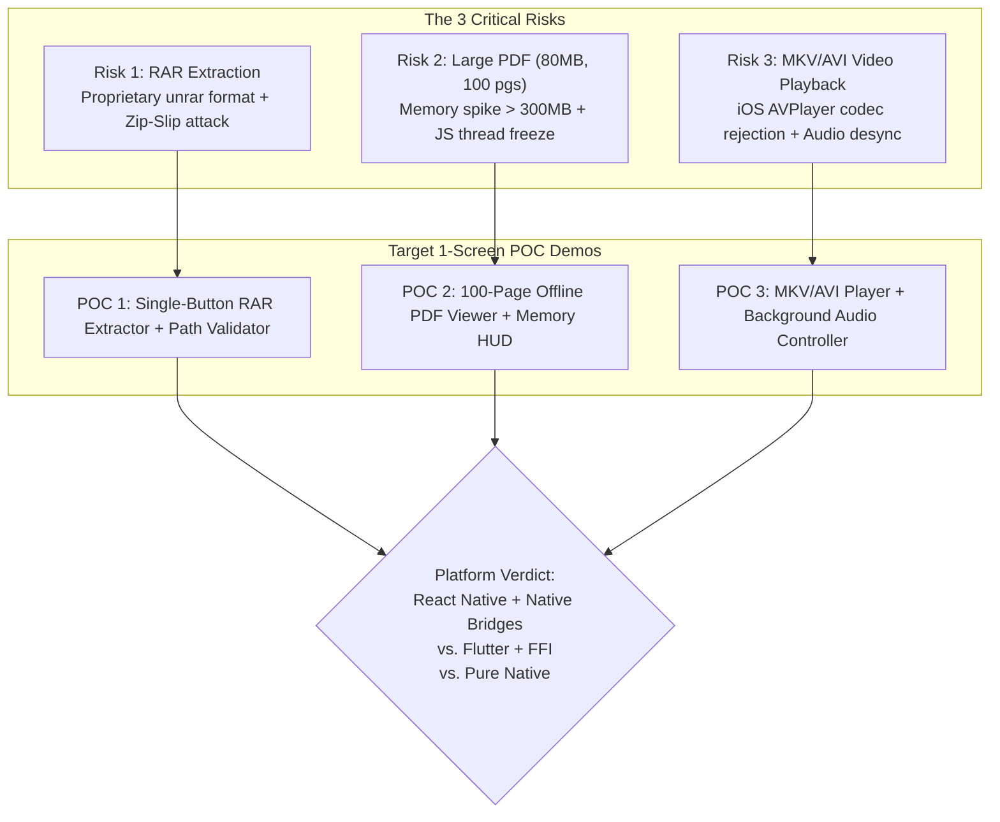
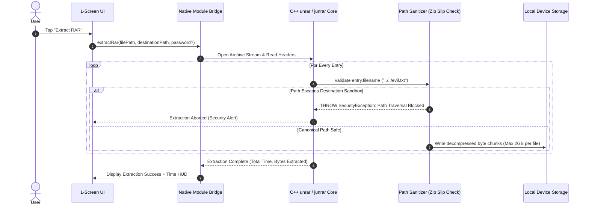
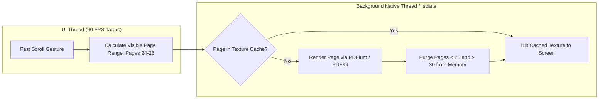
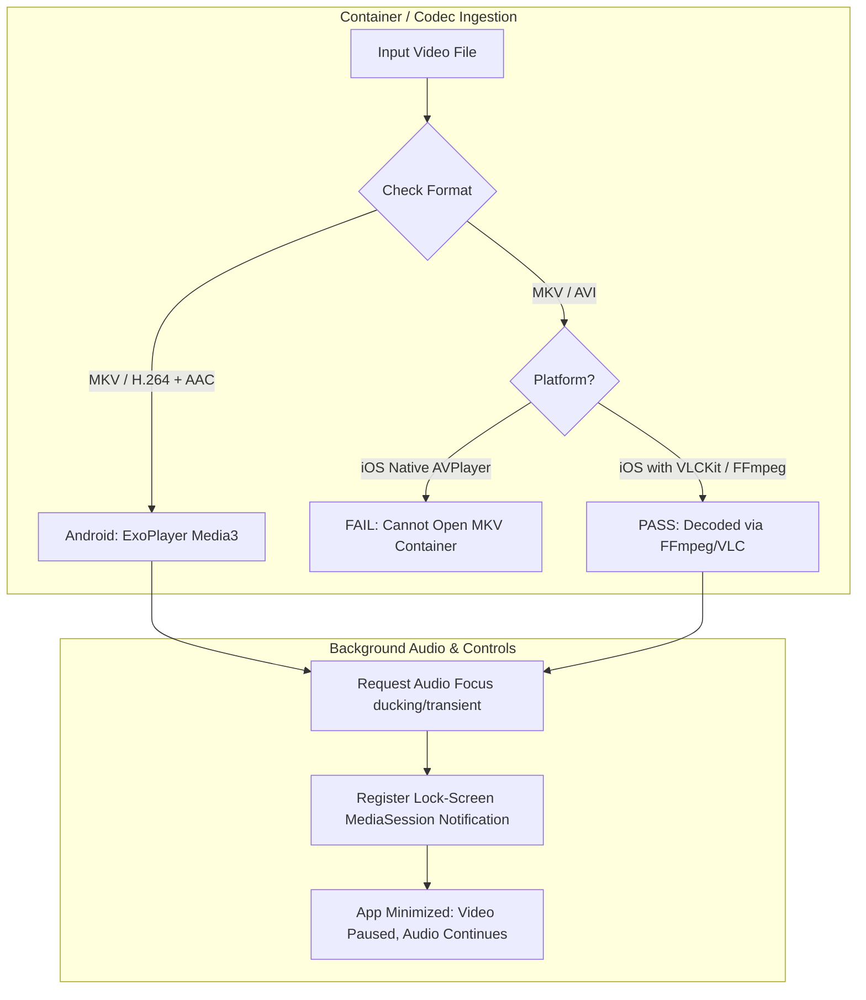
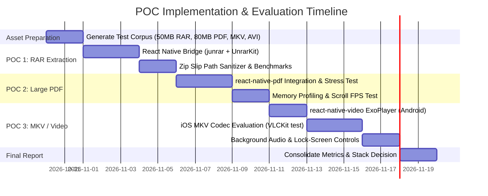

# PROOF OF CONCEPT (POC) MASTER PLAN
## Universal File Viewer — Critical Risk Validation: RAR, Large PDF & MKV Playback

---

**Document ID:** `UFV-POC-PLAN-001`  
**Purpose:** De-risk the 3 existential technical bottlenecks before full application development.  
**Tech Focus:** React Native (TypeScript) + Native Modules vs. Flutter (Dart) + C/C++ FFI vs. Pure Native.  
**Guiding Rule:** Minimal 1-Screen Demos, Real Test Files (No Mocks), Strict Metrics (Time, RAM, Errors).  

---

## 1. Executive Summary & Why These 3 POCs Matter

In consumer file utility apps, **90% of user drop-offs and 1-star reviews are caused by 3 failure modes**:
1. App crashes or freezes when extracting a `.rar` file.
2. App runs Out-Of-Memory (OOM) or stutters when scrolling an 80MB+ multi-page PDF.
3. Video player displays a black screen or "unsupported codec" when playing an `.mkv` or `.avi` file.



If React Native cannot handle these 3 capabilities smoothly with stable native bridges, proceeding with React Native will cause catastrophic delivery delays. This POC plan sets up a direct, measurable stress test.

---

## 2. Test File Corpus Specifications

To satisfy the strict rule of **"Real test files only, no dummy data"**, the following test files will be placed in the project test assets directory (`/test_assets/`):

| File Name | Format / Codec | Size / Content | Purpose |
| :--- | :--- | :--- | :--- |
| `sample_normal.rar` | RAR5 (standard compression) | 50 MB, 120 files across 4 nested directories (DOCX, JPG, TXT) | Test standard extraction speed & nested folder structure |
| `sample_encrypted.rar` | RAR5 (AES-256 encrypted) | 10 MB, password protected (`Pass@1234`) | Test password prompt, validation & error handling on wrong password |
| `sample_corrupt.rar` | RAR5 (corrupted byte offset) | 15 MB, deliberately truncated mid-archive | Test crash resilience & proper `CORRUPTED_ARCHIVE` error handling |
| `sample_zipslip.rar` | RAR4/5 with traversal paths | Contains `../../evil.txt` and `C:\Windows\evil.txt` | **Security Test:** Ensure path escapes are blocked 100% |
| `sample_large.pdf` | PDF 1.7 (embedded images & text) | 80 MB, 100 pages, mixed vector & raster graphics | Test cold render time, smooth scrolling & RAM consumption |
| `sample_video.mkv` | Matroska (MKV) | 1080p, H.264 video, AAC stereo audio, 3 min duration | Test MKV container parsing, HW decoding & seek speed |
| `sample_legacy.avi` | AVI container | 720p, Xvid/MPEG-4 video, MP3 audio, 2 min duration | Test legacy container compatibility (especially on iOS) |

---

## 3. POC 1: RAR Extraction & Security Sanitizer Benchmark

### 3.1 Objective & Technical Challenges
* **The Problem:** React Native has no pure JavaScript library that can decompress RAR5 archives. Standard community packages (`react-native-zip-archive`) use `Zip4j` on Android and `SSZipArchive` on iOS—**they only support `.zip`, not `.rar`**.
* **Android Reality:** Android requires wrapping a Java library like `junrar` (pure Java, handles RAR4 and basic RAR5, but slower) or compiling native C++ `unrar` via NDK.
* **iOS Reality:** iOS natively provides zero RAR support. It requires bridging a native Objective-C/C++ library like `UnrarKit` (wrapping official RARLAB `unrar` C++ source).
* **Cross-Platform Alternative (Flutter):** Flutter uses direct **Dart FFI** to bind compiled C/C++ `libunrar` binaries running on background worker isolates.



### 3.2 Security Rules (Zip Slip & Path Normalization)
Before any byte is written to the filesystem, the extraction engine must execute:
```typescript
// Canonical Path Validation Logic (Mandatory for both RN Native Module & Flutter FFI)
function isPathSafe(destinationDir: string, entryFileName: string): boolean {
    const cleanEntryName = entryFileName.replace(/^(\.\.[\/\\])+/, '');
    const resolvedPath = path.resolve(destinationDir, entryFileName);
    const resolvedDest = path.resolve(destinationDir);
    
    // Path must strictly start with destination directory
    return resolvedPath.startsWith(resolvedDest + path.sep);
}
```

### 3.3 Pass / Fail Criteria & Benchmark Thresholds
* [ ] **Speed (P0):** 50MB nested RAR extracts in **$< 10.0$ seconds** on mid-range Android test device.
* [ ] **Memory (P0):** Peak RAM during extraction must not exceed **$150\text{MB}$**.
* [ ] **Password Handling (P1):** Correct password extracts successfully. Incorrect password throws a clean error (`INVALID_PASSWORD`); **zero native crashes**.
* [ ] **Corruption Handling (P1):** Truncated/corrupt archive throws `CORRUPT_ARCHIVE_ERROR` gracefully; temporary files cleaned up.
* [ ] **Zip Slip Prevention (P0):** `sample_zipslip.rar` must be rejected immediately; **zero files written outside the sandbox target directory**.

### 3.4 Measurement Dashboard (Displayed on 1-Screen Demo)
```
+--------------------------------------------------+
|               POC 1: RAR EXTRACTOR               |
+--------------------------------------------------+
| [ Select: sample_normal.rar ]                    |
| [ Extract Archive (Button) ]                     |
+--------------------------------------------------+
| Status:           COMPLETED                      |
| Extraction Time:  6.42 seconds                   |
| Peak Memory:      112 MB                         |
| Files Extracted:  120 / 120                      |
| Zip Slip Shield:  ACTIVE (0 Escapes Detected)    |
| Errors:           None                           |
+--------------------------------------------------+
```

---

## 4. POC 2: Large PDF Offline Viewer (80MB, 100 Pages)

### 4.1 Objective & Technical Challenges
* **The Problem:** Rendering PDF pages inside a JavaScript/Webview bridge creates severe frame drops, UI thread locks, and out-of-memory (OOM) crashes when navigating an 80MB document.
* **React Native Approach:** Use `react-native-pdf` (which embeds native Android `PdfRenderer` / Google PDFium and iOS `PDFKit` via a Native UI Component).
* **Flutter Approach:** Use `pdfrx` or `syncfusion_flutter_pdfviewer` using native hardware texture pipelines.
* **Key Challenge:** Memory recycling. When the user rapidly flings from Page 1 to Page 100, off-screen rasterized page textures must be purged immediately from memory to prevent exceeding the 300MB OS limit.



### 4.2 Pass / Fail Criteria & Benchmark Thresholds
* [ ] **First Page Render Time (P0):** Cold open to first page display in **$< 2.0$ seconds**.
* [ ] **Scrolling Performance (P0):** Continuous scroll maintained at **$\ge 55$ FPS** without UI freezing.
* [ ] **Memory Cap (P0):** Peak memory must remain **$< 300\text{MB}$** even after rapid scrolling across all 100 pages.
* [ ] **Zoom / Pan Fidelity (P1):** Pinch-to-zoom re-renders vector text sharply without blur or crashes.
* [ ] **Offline Independence (P0):** Airplane mode turned ON; app opens and searches text with zero network access.

### 4.3 Measurement Dashboard (Displayed on 1-Screen Demo)
```
+--------------------------------------------------+
|           POC 2: LARGE PDF OFFLINE VIEWER        |
+--------------------------------------------------+
| [ Native PDF Viewport: Page 25 / 100 ]           |
|                                                  |
|  [Embedded Vector / Image Content]               |
|                                                  |
+--------------------------------------------------+
| HUD Telemetry:                                   |
| Cold Open Time:     1.48 seconds                 |
| Current RAM:        184 MB (Peak: 232 MB)        |
| Scroll Frame Rate:  58.4 FPS                     |
| Text Search Latency: 140 ms ("invoice")          |
+--------------------------------------------------+
```

---

## 5. POC 3: MKV/AVI Video Player & Audio Background Engine

### 5.1 Objective & Technical Challenges
* **The Problem:** 
  - **Android:** Android's native `MediaPlayer` fails on many MKV/AVI containers. However, Google's `ExoPlayer` (`androidx.media3`) handles MKV with H.264/AAC natively, but struggles with legacy AVI (DivX/Xvid) or AC3 audio unless compiled with native FFmpeg extensions.
  - **iOS:** Apple's native `AVPlayer` **completely refuses to open `.mkv` and `.avi` containers**. It strictly demands `.mp4`, `.mov`, or `.m4v`. Playing MKV/AVI on iOS requires a custom player core using **VLCKit / MobileVLCKit** or **FFmpeg (libavformat + libavcodec)**.
* **React Native Approach:** Test `react-native-video` (ExoPlayer on Android). On iOS, evaluate whether `react-native-video` fails on MKV, and test bridging `MobileVLCKit`.
* **Flutter Alternative:** `media_kit` (backed by `libmpv`), which compiles with embedded FFmpeg and natively plays MKV, AVI, FLV, and every desktop/mobile codec out of the box with zero native bridging code.



### 5.2 Pass / Fail Criteria & Benchmark Thresholds
* [ ] **Container Playback (P0):** `sample_video.mkv` plays immediately with synchronized audio and video.
* [ ] **Seek Latency (P0):** Seeking forward/backward 30 seconds completes in **$< 1.0$ second** without audio desync or frame freezing.
* [ ] **Legacy AVI Playback (P1):** Record whether `sample_legacy.avi` plays or requires an external FFmpeg/VLC decoder.
* [ ] **Background Audio & Lock-Screen (P0):** Minimizing the app switches seamlessly to background audio. Lock-screen media controls (Play, Pause, Seek) function accurately.
* [ ] **Audio Interruption (P1):** Incoming phone call pauses playback; hanging up resumes smoothly.

### 5.3 Measurement Dashboard (Displayed on 1-Screen Demo)
```
+--------------------------------------------------+
|              POC 3: MKV/AVI VIDEO PLAYER         |
+--------------------------------------------------+
| [ Video Surface: sample_video.mkv (01:24 / 03:00)]|
|                                                  |
| [ Play/Pause ]  [ << 10s ]  [ 10s >> ]           |
+--------------------------------------------------+
| Telemetry:                                       |
| Playback State:     PLAYING (H.264 / AAC)        |
| Seek Latency:       340 ms                       |
| Audio/Video Sync:   PERFECT (0 ms drift)         |
| Background Audio:   READY (Lock-Screen Active)   |
| AVI Compatibility:  TEST PENDING                 |
+--------------------------------------------------+
```

---

## 6. Execution Roadmap for Building the POCs



### Sprint 1: Test Assets & POC 1 (RAR Extraction)
1. **Asset Creation Script:** Run a script to generate the exact 50MB nested RAR, password RAR, corrupt RAR, and malicious `../../evil.txt` Zip-Slip test file.
2. **React Native Setup:** Create a minimal React Native project (`UFV-Poc-Runner`).
3. **Android Native Module:** Implement `RNRarExtractorModule.java` wrapping `com.github.junrar` or native `unrar` C++ library with Zip-Slip path normalization.
4. **iOS Native Module:** Implement `RNRarExtractorBridge.m` wrapping `UnrarKit`.
5. **Benchmark Run:** Measure extraction speed, RAM usage, and path traversal block.

### Sprint 2: POC 2 (Large PDF Offline Viewer)
1. **Asset Placement:** Place the 80MB, 100-page test PDF into the test runner assets.
2. **Integration:** Implement `react-native-pdf` inside a single screen with native texture rendering enabled.
3. **Telemetry Hook:** Attach memory profiler and measure cold open time (`performance.now()`).
4. **Stress Test:** Script automated fling gestures to cycle through all 100 pages within 10 seconds; record maximum memory allocation.

### Sprint 3: POC 3 (MKV Video Player & Audio Background)
1. **Android Integration:** Configure `react-native-video` with `ExoPlayer` (`VLC` fallback if AVI fails).
2. **iOS Codec Spike:** Test `react-native-video` on iOS with `sample_video.mkv`. If `AVPlayer` fails (expected behavior), integrate `react-native-vlc-media-player` or `MobileVLCKit`.
3. **Background Audio:** Hook into `react-native-track-player` or native Android `MediaSessionService` / iOS `MPNowPlayingInfoCenter` to verify lock-screen controls.

---

## 7. Post-POC Evaluation & Stack Decision Matrix Template

Upon completing the 3 POC runs, the findings will be compiled into the following **1-Page Final Evaluation Report**:

### 7.1 Scorecard Template

| Evaluation Dimension | POC 1: RAR Extraction (50MB) | POC 2: Large PDF (80MB, 100 pgs) | POC 3: MKV / AVI Video Player |
| :--- | :--- | :--- | :--- |
| **Pass / Fail Status** | `[PASS / FAIL]` | `[PASS / FAIL]` | `[PASS / FAIL]` |
| **Primary Metric** | Time: `___ s` (Target $< 10\text{s}$) | First Render: `___ s` (Target $< 2\text{s}$) | Seek Latency: `___ ms` (Target $< 1\text{s}$) |
| **Peak Memory (RAM)** | `___ MB` (Limit $< 150\text{MB}$) | `___ MB` (Limit $< 300\text{MB}$) | `___ MB` (Limit $< 200\text{MB}$) |
| **Key Failure / Bug Encountered** | *(e.g., Junrar failed on RAR5 solid archive)* | *(e.g., OOM crash when scrolling to page 72)* | *(e.g., iOS AVPlayer threw error code -11828)* |
| **Alternative Solution** | *(e.g., C++ NDK unrar via JSI)* | *(e.g., Google PDFium direct native view)* | *(e.g., MobileVLCKit on iOS)* |

### 7.2 Native Modules List Required if Choosing React Native
If React Native is selected for the production build, the following **custom native modules** must be engineered and maintained by the development agency (standard off-the-shelf JS libraries will not suffice):

1. **`RNRarBridge` (Custom Native Module):**
   - *Android:* C++ NDK wrapper around official RARLAB `unrar` source via JNI / TurboModule (to support both RAR4 & RAR5 solid archives with Zip Slip checks).
   - *iOS:* Objective-C++ wrapper around `UnrarKit` / `libunrar.a`.
2. **`RNPlatformPDFView` (Custom Native UI Component):**
   - Custom wrapper around Android `PdfRenderer` / PDFium and iOS `PDFKit` with aggressive tile caching and off-screen texture disposal.
3. **`RNExoVlcPlayer` (Hybrid Media Engine):**
   - *Android:* `androidx.media3.exoplayer` with software decoder extensions.
   - *iOS:* `MobileVLCKit` bridge to bypass Apple `AVPlayer`'s refusal to play MKV/AVI files.
4. **`RNSecureArchiveStorage` (Storage Access Bridge):**
   - Direct integration with Android Storage Access Framework (SAF) tree URIs and iOS Security-Scoped Bookmarks.

### 7.3 Decision Gate: When to Pivot to Flutter or Pure Native
* **Pivot to Flutter:** If React Native's iOS bridge for MKV (`MobileVLCKit`) and RAR (`UnrarKit`) adds $> 40\text{MB}$ app bloat, causes frequent thread deadlock, or fails to maintain 60 FPS scrolling on large PDFs, **pivot immediately to Flutter**. Flutter's `media_kit` (libmpv) and Dart C/C++ FFI solve these problems out-of-the-box with a unified codebase.
* **Pivot to Pure Native:** If neither cross-platform framework can maintain $< 250\text{MB}$ peak RAM while rendering 100MB documents and processing archives simultaneously on budget Android devices.

---

## 8. Immediate Next Actions

1. Review this POC Master Plan: [poc.md](file:///c:/Users/uditp/Desktop/Doc_Reader/poc.md).
2. Generate the 4 synthetic test files (`sample_normal.rar`, `sample_zipslip.rar`, `sample_large.pdf`, `sample_video.mkv`) using local scripts.
3. Scaffold the minimal single-screen demo to begin Phase 0 benchmark testing.

