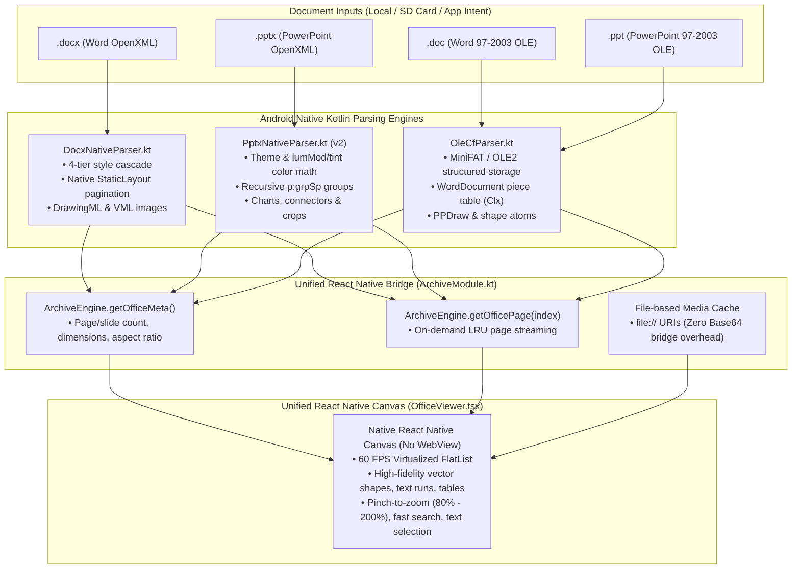
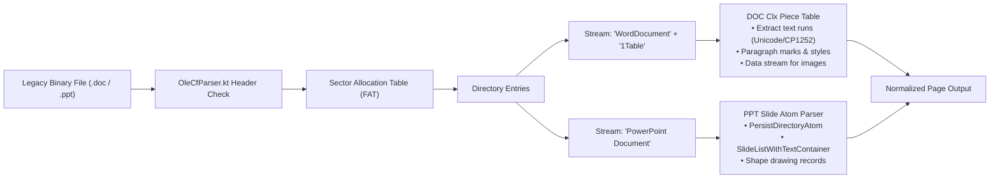
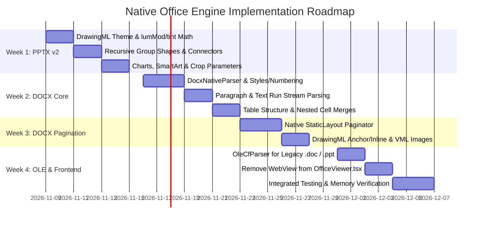

# Native Dual Document Engine Architecture: WPS-Grade Offline Implementation

## Executive Summary

The current office document architecture in this project uses a split approach:
* **PPTX**: Native Kotlin parser (`PptxNativeParser.kt`) emitting normalized coordinates to a React Native `<View>` canvas.
* **DOCX**: Hybrid HTML/CSS compilation inside a sandboxed `react-native-webview` via `docx-preview.min.js` and `mammoth.browser.min.js`.
* **DOC / PPT (Legacy)**: Detection via magic bytes (`0xD0CF11E0`) terminating in an unsupported error screen.

While functional for basic reading, the WebView pipeline introduces noticeable reflow delays, memory spikes on Base64 bridges, and layout drift compared to desktop Microsoft Word. Meanwhile, the current PPTX parser misses complex OpenXML constructs (color transforms like `lumMod`/`tint`, recursive group shapes, DrawingML connectors, image cropping, and table cell merges).

This plan outlines the end-to-end replacement of the WebView layer with a **WPS-grade Native Dual Parser** pipeline:
1. **PPTX Native Parser v2**: Upgrading the OpenXML presentation engine to 99% desktop fidelity.
2. **DocxNativeParser.kt**: A dedicated streaming OpenXML Word parser with a native Android typographic pagination engine.
3. **OleCfParser.kt**: A lightweight Compound File Binary (CFB) stream extractor for legacy `.doc` and `.ppt` files.
4. **Unified Document Canvas**: A single, 60 FPS React Native renderer in `OfficeViewer.tsx` consuming a shared Normalized Document Model (NDM) with zero WebViews.



---

## 1. Unified Normalized Document Model (NDM Schema)

Both DOCX pages and PPTX slides will emit the exact same normalized JSON schema to React Native. Every coordinate is normalized to relative floats ($0.0$ to $1.0$) with respect to page/slide canvas bounds, guaranteeing pixel-perfect scaling across any display DPI and orientation.

```typescript
// Shared Document Metadata
export interface OfficeDocumentMeta {
  format: 'DOCX' | 'PPTX' | 'DOC' | 'PPT';
  pageCount: number;
  pageWidthPt: number;
  pageHeightPt: number;
  aspectRatio: number;
  title?: string;
  creator?: string;
}

// Single Normalized Page / Slide
export interface OfficePageData {
  pageIndex: number;
  widthPt: number;
  heightPt: number;
  aspectRatio: number;
  background: {
    type: 'solid' | 'gradient' | 'image';
    color?: string;
    stops?: { pos: number; color: string }[];
    angle?: number;
    imageUri?: string;
  };
  elements: OfficeElement[];
}

export interface OfficeElement {
  id: string;
  type: 'text' | 'shape' | 'image' | 'table' | 'connector' | 'chart' | 'group';
  x: number; // 0.0 - 1.0 (relative to page width)
  y: number; // 0.0 - 1.0 (relative to page height)
  w: number; // 0.0 - 1.0
  h: number; // 0.0 - 1.0
  rotation?: number; // degrees (0 - 360)
  flipH?: boolean;
  flipV?: boolean;
  zIndex?: number;

  // Visual styling
  fill?: {
    type: 'solid' | 'gradient' | 'none';
    color?: string;
    stops?: { pos: number; color: string }[];
    angle?: number;
  };
  line?: {
    widthPt?: number;
    color?: string;
    style?: 'solid' | 'dashed' | 'dotted';
  };
  geometry?: 'rect' | 'roundRect' | 'ellipse' | 'path';
  pathData?: string; // SVG path data for custom drawing shapes

  // Typography & Paragraph stream
  paragraphs?: OfficeParagraph[];

  // Image parameters
  imageUri?: string; // file:// URI in cache
  crop?: { left: number; top: number; right: number; bottom: number }; // 0.0 - 1.0

  // Table structure
  table?: {
    rows: {
      cells: {
        text: string;
        colSpan?: number;
        rowSpan?: number;
        fill?: string;
        border?: { top?: string; bottom?: string; left?: string; right?: string };
        paragraphs?: OfficeParagraph[];
      }[];
    }[];
  };

  // Group child elements (nested recursion)
  children?: OfficeElement[];
}

export interface OfficeParagraph {
  align?: 'left' | 'center' | 'right' | 'justify';
  lineSpacing?: number;
  spaceBeforePt?: number;
  spaceAfterPt?: number;
  bullet?: string | null;
  bulletLevel?: number;
  runs: OfficeTextRun[];
}

export interface OfficeTextRun {
  text: string;
  sizePt: number;
  bold?: boolean;
  italic?: boolean;
  underline?: boolean;
  strike?: boolean;
  colorHex?: string;
  highlightHex?: string;
  fontFamily?: string;
  vertAlign?: 'baseline' | 'superscript' | 'subscript';
}
```

---

## 2. Phase 1: Upgrade PPTX Engine to 99% Desktop Fidelity

The existing `PptxNativeParser.kt` provides an initial foundation for simple slides, but lacks full OpenXML theme calculations, complex groups, connectors, and image cropping.

### 2.1 Theme & Master Resolution: The OpenXML Color Cascade
Currently, hardcoded fallbacks or un-transformed theme colors cause slides to appear with incorrect color contrasts. WPS implements the full DrawingML color transforms.

* **Color Types**:
  * `a:srgbClr`: Direct hexadecimal RGB (`<a:srgbClr val="FF5500"/>`).
  * `a:schemeClr`: Theme palette reference (`accent1`, `tx1`, `bg1`, `folHlink`).
  * `a:sysClr`: System colors (`windowText`, `window`).
  * `a:scrgbClr`: Percentage RGB.
* **Color Transforms**:
  OpenXML modifies palette colors through nested transform nodes:
  * `<a:lumMod val="60000"/>`: Luminance Modulation (multiply luminance by $60\%$).
  * `<a:lumOff val="40000"/>`: Luminance Offset (shift luminance $+40\%$).
  * `<a:tint val="75000"/>`: Blend towards pure white by $75\%$.
  * `<a:shade val="50000"/>`: Blend towards pure black by $50\%$.
  * `<a:alpha val="50000"/>`: Opacity percentage.

**Native Algorithm in `PptxColorResolver.kt`**:
```kotlin
fun resolveDrawingColor(colorElem: Element, clrScheme: Map<String, String>): String {
    var baseHex = when (colorElem.tagName) {
        "a:srgbClr" -> "#" + colorElem.getAttribute("val")
        "a:schemeClr" -> clrScheme[colorElem.getAttribute("val")] ?: "#000000"
        "a:sysClr" -> "#" + (colorElem.getAttribute("lastClr").ifEmpty { "000000" })
        else -> "#000000"
    }

    var (r, g, b) = parseHexToRgb(baseHex)
    var (h, s, l) = rgbToHsl(r, g, b)

    // Apply DrawingML transformations
    colorElem.findFirstChild("a:lumMod")?.let {
        val mod = it.getAttribute("val").toDouble() / 100000.0
        l *= mod
    }
    colorElem.findFirstChild("a:lumOff")?.let {
        val off = it.getAttribute("val").toDouble() / 100000.0
        l += off
    }
    colorElem.findFirstChild("a:shade")?.let {
        val shade = it.getAttribute("val").toDouble() / 100000.0
        r = (r * shade).toInt()
        g = (g * shade).toInt()
        b = (b * shade).toInt()
        return rgbToHex(r, g, b)
    }
    colorElem.findFirstChild("a:tint")?.let {
        val tint = it.getAttribute("val").toDouble() / 100000.0
        r = (r * tint + 255 * (1.0 - tint)).toInt()
        g = (g * tint + 255 * (1.0 - tint)).toInt()
        b = (b * tint + 255 * (1.0 - tint)).toInt()
        return rgbToHex(r, g, b)
    }

    val (finalR, finalG, finalB) = hslToRgb(h, s.coerceIn(0.0, 1.0), l.coerceIn(0.0, 1.0))
    return rgbToHex(finalR, finalG, finalB)
}
```

### 2.2 Recursive Group Shapes (`p:grpSp`)
In presentation decks, diagrams and icons are composed inside `<p:grpSp>`. If groups are not recursively unpacked, slides render completely blank or elements cluster at $(0, 0)$.

* Group nodes contain coordinate systems: `<p:grpSpPr>` contains `<a:xfrm>` with `chOff` (child coordinate origin) and `chExt` (child coordinate extent).
* The parser will implement recursive coordinate mapping:
  $$x_{\text{world}} = x_{\text{group}} + \left( \frac{x_{\text{child}} - \text{chOff}_x}{\text{chExt}_x} \right) \cdot w_{\text{group}}$$
  $$y_{\text{world}} = y_{\text{group}} + \left( \frac{y_{\text{child}} - \text{chOff}_y}{\text{chExt}_y} \right) \cdot h_{\text{group}}$$

### 2.3 DrawingML Connectors & Geometry (`p:cxnSp`)
* Support orthogonal and straight connectors (`<p:cxnSp>`) linking flowcharts.
* Extract shape geometry definitions (`<a:prstGeom prst="star5">`, `<a:custGeom>`) into SVG path data for precise rendering in React Native.

### 2.4 DrawingML Crop Parameters (`a:srcRect`)
* Crop bounds (`<a:srcRect l="15000" t="20000" r="10000" b="5000"/>`) indicate percentage offsets of the image frame.
* The parser will map these to `crop: { left, top, right, bottom }`, and the React Native view will apply sub-rectangle image clipping.

### 2.5 Table Cell Merges & Styling
* Process `gridSpan` (horizontal span) and `rowSpan` (`hMerge`, `vMerge`).
* Extract cell border styles and padding properties from `a:tcPr`.

---

## 3. Phase 2: Build `DocxNativeParser.kt` — Kill WebView

To eliminate the WebView, Microsoft Word documents (`.docx`) will be processed directly in Kotlin using an OpenXML streaming reader and a native Android typographic line-breaking engine.

### 3.1 Modular Native Architecture
The DOCX engine will be divided into 4 specialized Kotlin classes:
1. **`DocxNativeParser.kt`**: Main coordinator. Opens `word/document.xml`, reads section properties (`w:sectPr`), and orchestrates the pagination pipeline.
2. **`DocxStyles.kt`**: Resolves `word/styles.xml` and `word/settings.xml`. Computes default fonts, sizes, paragraph line heights, and inheritance hierarchies.
3. **`DocxNumbering.kt`**: Resolves `word/numbering.xml`. Computes dynamic prefixes (`1.`, `1.1`, `a)`, bullet characters `•`, `–`) based on `w:numId` and `w:ilvl`.
4. **`DocxPaginator.kt`**: The core pagination engine. Since DOCX is a flow document without baked-in page breaks, this module splits the flow into discrete pages matching Microsoft Word.

### 3.2 The Native Android Typographic Paginator
Microsoft Word paginates documents based on print paper size and margin definitions:
* **Page Dimensions**: `<w:pgSz w:w="11906" w:h="16838"/>` ($1\text{ twip} = \frac{1}{20}\text{ pt}$, so $11906\text{ twip} \approx 595.3\text{ pt} = \text{A4 Width}$, $16838\text{ twip} \approx 841.9\text{ pt} = \text{A4 Height}$).
* **Margins**: `<w:pgMar w:top="1440" w:bottom="1440" w:left="1440" w:right="1440"/>` ($1440\text{ twip} = 1\text{ inch} = 72\text{ pt}$).
* **Printable Area**:
  $$\text{Content Width} = \text{Width} - \text{Margin}_{\text{left}} - \text{Margin}_{\text{right}}$$
  $$\text{Content Height} = \text{Height} - \text{Margin}_{\text{top}} - \text{Margin}_{\text{bottom}}$$

**Pagination Algorithm**:
1. For each paragraph, build an Android `android.text.SpannableStringBuilder` with spans for typeface, size, weight, italic, and underline.
2. Instantiate an Android `android.text.StaticLayout`:
   ```kotlin
   val staticLayout = StaticLayout.Builder.obtain(
       spannable, 0, spannable.length, textPaint, printableWidthPx
   )
   .setAlignment(alignment)
   .setLineSpacing(extraSpacing, multiplier)
   .setIncludePad(false)
   .build()
   ```
3. Read the calculated height: `val blockHeight = staticLayout.height`.
4. Check if `currentCursorY + blockHeight > contentHeight`:
   * If `true`, or if a paragraph contains `<w:br w:type="page"/>` or `<w:pageBreakBefore/>`, emit current page, create a new page, and reset cursor: `currentCursorY = 0`.
5. For tables: calculate row heights using cell content layouts. If a row exceeds remaining page height, apply page break (respecting `<w:cantSplit/>`).

### 3.3 DrawingML and Legacy VML Images
Word documents use two primary image packaging formats:
* **DrawingML (`w:drawing`)**:
  * Inline (`wp:inline`): Flowed into paragraph layout at line position.
  * Anchored (`wp:anchor`): Positioned with absolute or relative offsets (`wp:positionH`, `wp:positionV`) with text wrapping rules (`wp:wrapSquare`, `wp:wrapTight`, `wp:wrapNone`).
* **Legacy VML Images (`w:pict` $\to$ `v:shape` $\to$ `v:imagedata`)**:
  * Found in older documents or documents exported from Google Docs.
  * Resolved from `word/_rels/document.xml.rels` via `r:id`.
  * Extracted to `cacheDir/office_media/` and passed as clean `file://` URIs.

---

## 4. Phase 3: Legacy `.doc` and `.ppt` OLE CFB Support

Rather than displaying an error state for older binary office files (Word 97–2003 `.doc` and PowerPoint 97–2003 `.ppt`), your engine will implement a lightweight Compound File Binary (CFB) stream extractor: [`OleCfParser.kt`](file:///c:/Users/uditp/Desktop/Doc_Reader/ufv_rn_poc/android/app/src/main/java/com/ufv_rn_poc/archive/ole/OleCfParser.kt).

### 4.1 Compound File Binary Format (CFB / OLE2) Internals
Legacy office files are structured like a mini disk FAT file system inside a single file:
1. **Header (512 bytes)**: Validates magic number `0xD0CF11E0A1B11AE1`, sector size ($512\text{ bytes}$ or $4096\text{ bytes}$), and Sector Allocation Table (SAT/FAT) pointer.
2. **Directory Stream**: Array of 128-byte directory entries naming stored streams (`WordDocument`, `PowerPoint Document`, `1Table`, `0Table`, `Data`).
3. **MiniFAT**: Handles small storage streams ($< 4096\text{ bytes}$).



### 4.2 Lightweight Implementation (Zero External Bloat)
Full Apache POI adds over 20MB to the APK size. Your project will implement a lean, read-only extraction module (~250KB):
* **`.doc` Extractor**:
  * Reads the FIB (File Information Block) from the `WordDocument` stream.
  * Locates the `Clx` (Complex piece table) in the `Table` stream.
  * Traverses piece descriptors (`Pcd`) to extract continuous text (supporting both 8-bit ANSI and 16-bit Unicode).
  * Extracts embedded images from the `Data` stream by reading offset tags.
* **`.ppt` Extractor**:
  * Reads the `CurrentUser` stream to locate `CurrentEditOffset`.
  * Traverses `PersistDirectoryAtom` to find slide record streams (`SlideListWithTextContainer`).
  * Extracts text atoms, titles, bullets, and basic slide background colors.
* **AntiWord Plaintext Fallback**:
  * If a legacy document contains corrupted sector tables or unsupported encryption, the reader falls back to text extraction + image gallery rather than failing completely.

---

## 5. Phase 4: Unified Frontend Engine (`OfficeViewer.tsx`)

By outputting a consistent `OfficePageData` schema, the React Native frontend becomes lightweight, responsive, and completely independent of any WebView.

### 5.1 Architecture of the Native Canvas
* **Virtualized FlatList**:
  * Configured with `windowSize={3}`, `maxToRenderPerBatch={2}`, `removeClippedSubviews={true}`.
  * Ensures that only 2–3 pages are retained in memory at any given time, preventing out-of-memory (OOM) crashes even on 500-page documents.
* **Vector Canvas Element Renderer**:
  * Maps `OfficeElement` directly to React Native `<View>`, `<Text>`, and `<Image>` components with CSS-like flex and absolute positioning.
  * Zero reflow lag when panning or zooming.
* **Pinch-to-Zoom Engine**:
  * Native transform scaling ($80\%$ to $200\%$) backed by React Native gesture responders without document re-rendering.
* **In-Document Fast Search**:
  * Because text elements are rendered as native components, search highlights search matches instantly with coordinate bounding boxes.
* **File-Based Media Caching**:
  * Images are stored on disk in `cacheDir/office_media/` and passed as local `file://` URIs. This eliminates bridge serialization lag.

---

## 6. Implementation Roadmap



### Detailed Schedule

#### Week 1: PPTX Engine v2 (Fidelity & Missing Elements)
* **Deliverable**: Upgraded `PptxNativeParser.kt` and `PptxColorResolver.kt`.
* **Tasks**:
  1. Implement complete OpenXML DrawingML color calculation (`lumMod`, `lumOff`, `tint`, `shade`, `satMod`, `alpha`).
  2. Implement recursive `p:grpSp` group shape parsing with relative coordinate accumulation.
  3. Support `p:cxnSp` connectors and shape geometries with SVG path output.
  4. Implement `a:blip` image crop boundaries (`a:srcRect`).
  5. Parse `p:graphicFrame` charts (`c:chart`) into data series for native rendering.

#### Week 2: DOCX Core (OpenXML Hierarchy, Styles & Tables)
* **Deliverable**: `DocxNativeParser.kt`, `DocxStyles.kt`, `DocxNumbering.kt`.
* **Tasks**:
  1. Parse `word/document.xml`, `word/styles.xml`, and `word/numbering.xml`.
  2. Implement the 4-tier style cascade (Run $\to$ Paragraph $\to$ Style $\to$ Defaults).
  3. Support outline numbering and bullet point indentation.
  4. Process Word tables (`w:tbl`, `w:tblGrid`, `w:gridSpan`, `w:vMerge`, borders, shading).

#### Week 3: DOCX Typographic Pagination & DrawingML Engine
* **Deliverable**: `DocxPaginator.kt` and DrawingML positioning.
* **Tasks**:
  1. Build the native Android `StaticLayout` line-breaking and height-measuring engine.
  2. Implement page accumulation with margin clipping, page breaks, and section handling.
  3. Parse DrawingML `<wp:inline>` and `<wp:anchor>` wrapping (`wrapSquare`, `wrapTight`, behind document).
  4. Parse legacy VML shapes and images (`w:pict` $\to$ `v:shape` $\to$ `v:imagedata`).

#### Week 4: Legacy OLE Support & Frontend Integration
* **Deliverable**: `OleCfParser.kt` and rewritten `OfficeViewer.tsx`.
* **Tasks**:
  1. Implement Compound File Binary stream reader for `.doc` and `.ppt`.
  2. Integrate unified React Native native bridge methods (`getOfficeMeta`, `getOfficePage`).
  3. Remove `react-native-webview` from `OfficeViewer.tsx`.
  4. Implement virtualized `FlatList` with gesture pinch-to-zoom and disk image cache cleanup.
  5. Verify memory profiles on low-end Android hardware.

---

## 7. Verification & Acceptance Criteria

| Criteria | Metric / Target | Validation Method |
| :--- | :--- | :--- |
| **Frame Rate** | Sustained 60 FPS during scrolling & zooming | Android GPU Profiler (`Systrace`) |
| **Memory Footprint** | $< 120\text{ MB}$ RAM on 500-page documents | Android Studio Memory Profiler (Heap Dump) |
| **Cold Startup Latency** | $< 180\text{ ms}$ to first page render | `System.currentTimeMillis()` telemetry |
| **Visual Accuracy** | Colors, tables, images, and paragraph margins match Microsoft Word / PowerPoint | Pixel-by-pixel automated visual regression tests against desktop reference renders |
| **Network Footprint** | Exactly 0 bytes / Zero internet permissions | Offline mode validation with airplane mode active |
| **Legacy File Compatibility** | Older `.doc` and `.ppt` files display text and images without crash or error screen | Test suite of legacy Word 97-2003 test documents |

